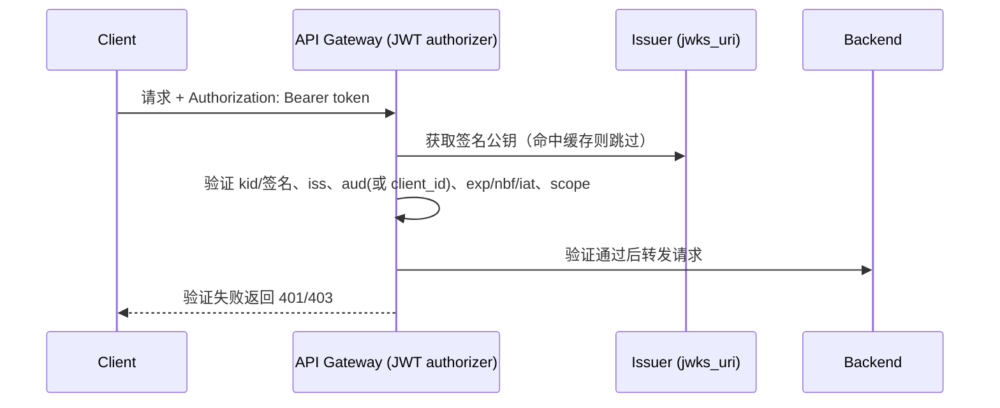

## Definition

Amazon API Gateway 是 AWS 的 managed API gateway service，可创建 REST、HTTP 和 WebSocket APIs，并把 route/method integration 到 Lambda、HTTP backend 或其他 AWS 服务。

## Key Terms

| 中文 | English | 含义 |
| --- | --- | --- |
| 路由 | Route | 由 HTTP method + path 选出的入口 |
| 集成 | Integration | 把请求转交给后端（Lambda、HTTP 服务等） |
| 授权器 | Authorizer | 在请求到达后端之前做身份验证和授权的组件 |
| JWT 授权器 | JWT Authorizer | HTTP API 用于验证 OAuth 2.0/OIDC JWT 的授权器 |
| Lambda 授权器 | Lambda Authorizer | 用 Lambda 函数执行自定义授权逻辑 |
| 资源策略 | Resource Policy | 按来源 IP、VPC endpoint 允许或拒绝访问的策略（REST API） |
| API 密钥 / 用量计划 | API Key / Usage Plan | 用于识别调用方和限流计费，而不是用户认证 |
| 阶段 | Stage | API 部署后的运行环境，如 `dev`、`prod` |

## REST API vs HTTP API

| 特性 | REST API | HTTP API |
| --- | --- | --- |
| 定位 | 功能更多 | 功能精简，价格更低 |
| IAM 授权 | 支持 | 支持 |
| Cognito | Cognito user pool authorizer | 通过 JWT authorizer |
| JWT authorizer | 不支持（可用 Lambda authorizer 验证 JWT） | 支持 |
| Lambda authorizer | 支持 | 支持 |
| 资源策略 | 支持 | 不支持 |
| API keys、per-client throttling、developer portal | 支持 | 不支持 |
| AWS WAF、缓存、Private endpoint | 支持 | 不支持 |
| 部署 | 用户手动部署到 stage | 支持自动部署 |

需要 API key、按客户端限流、请求校验、WAF 或私有端点时选 REST API；不需要这些功能时，HTTP API 更简单便宜。

## Identity Options

- AWS IAM authorization：适合使用 AWS credentials/SigV4 的 caller。
- Cognito user pool authorizer（REST API）：验证 [[Amazon Cognito]] 签发的 identity token 或 access token。
- JWT authorizer（HTTP API）：验证 standards-based OAuth 2.0/OIDC JWT。
- Lambda authorizer：执行 custom token/request-based logic。

API Gateway 通常验证 token，但不是必然的 [[Identity Provider]]，也不会自动替业务服务完成所有 resource-level [[Authorization]]。

## JWT Authorizer in Practice

- 只支持 RSA 系列算法；公钥最多缓存两小时，缓存未命中时需要联网获取，会增加该请求的延迟；轮换密钥时要留一段宽限期，让新旧密钥同时有效。
- 没有标准方法区分 access token 与 ID token，因此除非需要用 ID token 授权，否则建议要求授权 scope，或者要求 issuer、audience 只匹配 IdP 签发 access token 时使用的值。
- 校验项目的完整说明见 [[Token Validation]]。

## Routing

Route 通常由 HTTP method + path 选择 integration。固定 domain 可以有 `/projects/a/prompts`、`/projects/b/prompts` 或 `/projects/{projectId}/prompts` 等多个 route。

## Gotchas

- REST API 与 HTTP API 支持的 authorizer 和功能不同。
- REST API 需要把修改部署到正确 stage 才能生效；HTTP API 可以开启自动部署。
- API key 用于 usage plan/consumer tracking 时，不应替代 user authentication。

## Connections

- Broader concept: [[API Gateway]]
- Enterprise layer: [[IBM API Connect]]
- Backend: [[AWS Lambda]]
- Service permissions: [[AWS IAM]]
- Identity: [[Amazon Cognito]]、[[Token Validation]]

## Sources

- [Choose between REST APIs and HTTP APIs](https://docs.aws.amazon.com/apigateway/latest/developerguide/http-api-vs-rest.html)
- [Control access to REST APIs](https://docs.aws.amazon.com/apigateway/latest/developerguide/apigateway-control-access-to-api.html)
- [Control access to HTTP APIs with JWT authorizers](https://docs.aws.amazon.com/apigateway/latest/developerguide/http-api-jwt-authorizer.html)
- [API Gateway with Cognito user pools](https://docs.aws.amazon.com/apigateway/latest/developerguide/apigateway-integrate-with-cognito.html)
