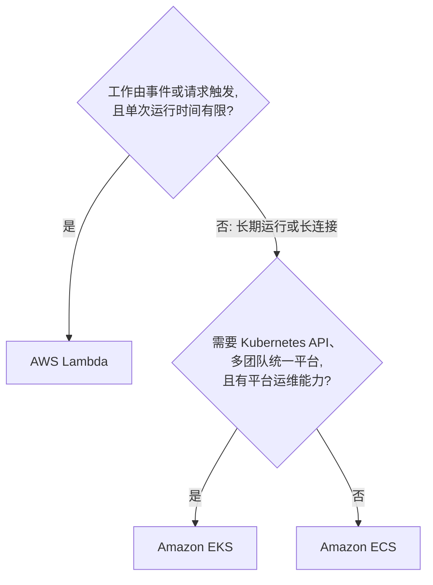

## Purpose

AWS Compute Options 是一张工作负载选型地图。用户数、QPS 或服务数量都不是选择 Kubernetes 的固定门槛；应根据执行模型、运行时间、流量形态、隔离、可移植性、团队能力和成本选择。

## Key Terms

| 中文 | English | 含义 |
| --- | --- | --- |
| 函数调用 | Function Invocation | Lambda 的运行单位，每次调用相互独立 |
| 容器任务 / 服务 | Container Task / Service | ECS 的运行单位 |
| 工作负载 | Workload | 在 Kubernetes 上运行的应用单位，如 Deployment |
| 无服务器 | Serverless | 不需要预置和管理服务器 |
| 可移植性 | Portability | 迁移到其他平台的难易程度 |
| 执行模型 | Execution Model | 请求驱动、事件驱动还是长期运行 |

## Comparison

| Dimension | [[AWS Lambda]] | [[Amazon ECS]] | [[Amazon EKS]] |
| --- | --- | --- | --- |
| Unit | Function invocation | Container task/service | Kubernetes workload |
| Best fit | 事件驱动、短时和突发任务 | 长时间运行的容器服务与 Worker | 需要 Kubernetes API 和平台生态的多工作负载环境 |
| Scaling | 按调用并发扩展 | Service Auto Scaling | HPA、KEDA 等 |
| Operations | 较低 | 低至中 | 中至高（Auto Mode 可减轻节点运维） |
| Portability | AWS 绑定较强 | 容器可移植，控制面 AWS 化 | Kubernetes API 相对可移植，但云集成仍有差异 |
| Capacity | AWS 管理 | Fargate、EC2、Managed Instances | 节点由用户管理，或使用 Auto Mode |

Lambda 现在有 Event Functions、Web Functions 和 MicroVMs 三种计算原语，选型时先确认你要的是哪一种，详见 [[AWS Lambda]]。

## Decision Flow

这是一个起点而不是规则：最终还要看成本、下游容量、团队熟悉度和合规要求。

## Decision Questions

- 工作是请求驱动、事件驱动还是长期运行？
- 是否可能超过单次执行时间限制或需要长连接？
- 是否已有成熟的 [[Kubernetes]] 平台能力？
- 需要怎样的部署、流量切换和资源调度？
- 持续高负载下，按调用还是长期容器更经济？
- 下游容量是否支持计算层扩容？

## Connections

### Options
- [[AWS Lambda]]
- [[Amazon ECS]]
- [[Amazon EKS]]

### Architecture qualities
- [[Scalability]]
- [[High Availability]]
- [[Reliability]]

### Workload pattern
- [[Reliable Asynchronous Processing]]

## Sources

- [What is AWS Lambda](https://docs.aws.amazon.com/lambda/latest/dg/welcome.html)
- [What is Amazon ECS](https://docs.aws.amazon.com/AmazonECS/latest/developerguide/Welcome.html)
- [What is Amazon EKS](https://docs.aws.amazon.com/eks/latest/userguide/what-is-eks.html)
