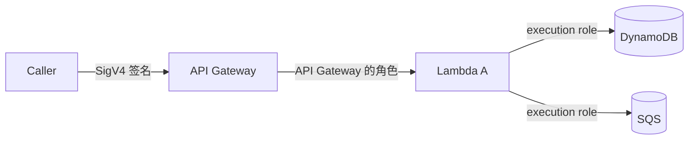
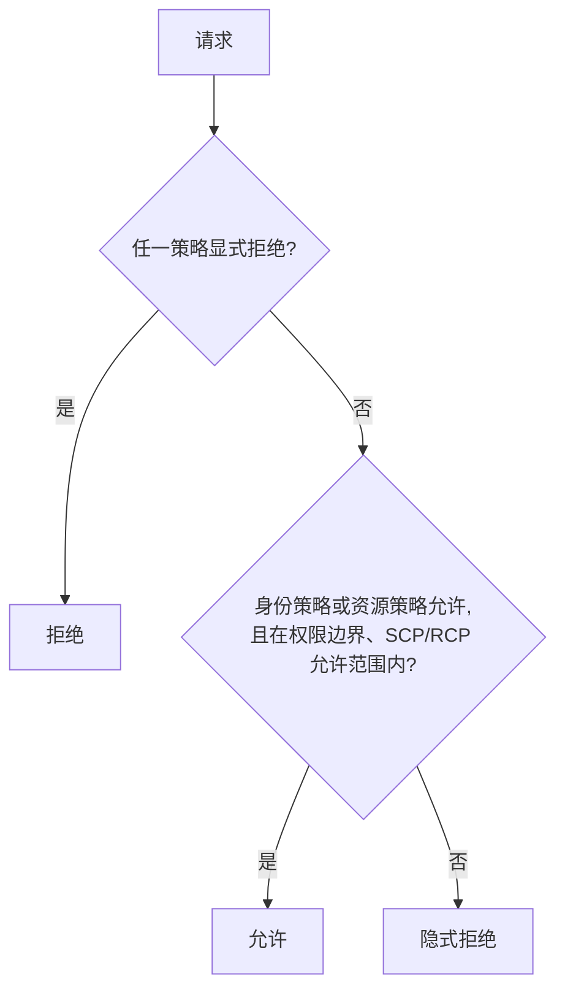

## Definition

AWS Identity and Access Management（IAM）控制 AWS principals 对 AWS resources 执行 actions 的权限。Principals 包括 IAM users、roles、federated sessions 和 AWS services。

## Key Terms

| 中文 | English | 含义 |
| --- | --- | --- |
| 主体 | Principal | 发出请求的实体：IAM user、角色、联合身份、应用等 |
| 身份策略 | Identity-based Policy | 附加在用户、组或角色上的策略 |
| 资源策略 | Resource-based Policy | 附加在资源上的策略，例如 Lambda 或队列的访问策略 |
| 权限边界 | Permissions Boundary | 限制身份策略最多能授予多少权限 |
| 服务控制策略 | SCP（Service Control Policy） | AWS Organizations 对成员账号的权限上限 |
| 显式拒绝 | Explicit Deny | 策略里明确写出的 Deny，优先级最高 |
| 隐式拒绝 | Implicit Deny | 没有任何策略允许时默认被拒绝 |
| 角色 / 执行角色 | Role / Execution Role | 可被扮演的身份；服务以它的权限运行，如 Lambda execution role |
| SigV4 | Signature Version 4 | 用 AWS 凭证对请求签名的方式 |

## In an API Architecture

- API Gateway execution role 是否能调用某个 backend。
- Lambda execution role 是否能读写 DynamoDB、SQS 或 Secrets Manager。
- Lambda A 是否具有调用 Lambda B 的 permission。
- 使用 SigV4 的 caller 是否能够调用受 IAM 保护的 API Gateway route。

## How Permissions Are Combined

同一账号内，AWS 评估请求时：

- **身份策略与资源策略取并集**：只要其中之一允许，操作就被允许。
- **权限边界取交集**：身份策略再叠加权限边界，只能得到两者共同允许的权限。
- **Organizations 的 SCP、RCP 取交集**：操作必须被所有这些策略类型允许。
- **显式拒绝总是覆盖允许**，不论它出现在哪种策略里。
- 没有被任何策略允许的请求，默认被隐式拒绝。

这张图是简化的，完整规则（会话策略、跨账号等）见官方的 policy evaluation logic。

## What It Does Not Replace

“Lambda A 有权调用 Lambda B”不等于“当前员工有权访问 Project B”。前者是 service/resource permission；后者是 end-user [[Authorization]]，通常依赖 [[Access Token]] claims 和业务 policy。

## Gotchas

- IAM 是最终一致的：创建或修改后，变更需要时间复制到各处，所以刚改完策略的瞬间可能还没生效。
- 不要把 root user 用于日常任务。

## Connections

- [[AWS API Gateway]]
- [[AWS Lambda]]
- [[Amazon Cognito]]
- [[Authentication]]
- [[Authorization]]

## Sources

- [What is IAM](https://docs.aws.amazon.com/IAM/latest/UserGuide/introduction.html)
- [Policy evaluation logic](https://docs.aws.amazon.com/IAM/latest/UserGuide/reference_policies_evaluation-logic.html)
