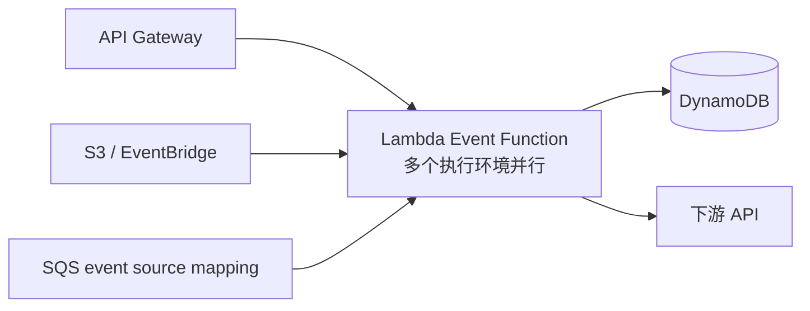
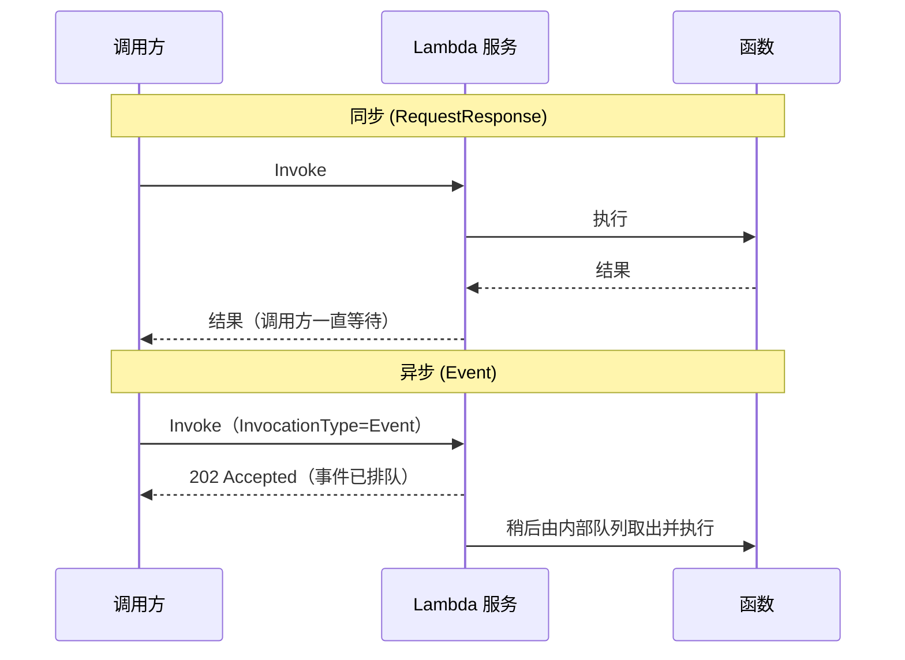
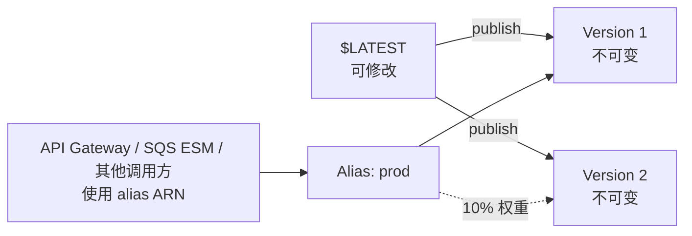

## Definition

AWS Lambda 是无服务器（serverless）计算服务：应用提供代码，AWS 管理服务器维护、容量、扩缩容和补丁。当前 Lambda 提供三种计算原语（compute primitive），在默认计算类型下，底层都用 Firecracker 提供 VM 级别隔离，并且按使用付费、网络由服务托管：

- **Event Functions**：由事件或 API 调用触发的函数，原来的 Lambda 函数类型，本文主要讲它。
- **Web Functions**：把 Web 应用作为 HTTP 服务器运行，一个执行环境同时处理多个请求。
- **MicroVMs**：近乎瞬时启动的隔离环境，由开发者控制创建、挂起、恢复和终止，适合为单个用户或任务提供专用环境。

## Key Terms

| 中文 | English | 含义 |
| --- | --- | --- |
| 事件函数 | Event Function | 由触发器调用、每次调用相互独立的函数 |
| 同步 / 异步调用 | Synchronous / Asynchronous Invocation | 调用方等待结果 / Lambda 先排队、立即返回 |
| 执行环境 | Execution Environment | 运行函数代码的隔离环境，Lambda 根据请求量自动增减其数量 |
| 并发 | Concurrency | 同一时刻正在处理请求的执行环境数量 |
| 预留并发 | Reserved Concurrency | 为某个函数保留并发上限和下限，其他函数不能使用这部分并发 |
| 预置并发 | Provisioned Concurrency | 预先初始化一批执行环境，用来降低冷启动延迟 |
| 冷启动 | Cold Start | 新执行环境初始化带来的额外延迟 |
| 事件源映射 | Event Source Mapping（ESM） | Lambda 轮询队列或流，并把批次数据同步调用函数的组件 |
| 部分批次响应 | Partial Batch Response | 函数只把失败的消息上报，只有它们会被重试 |
| 版本 | Version | 从 `$LATEST` 发布出的函数快照，发布后基本不可变 |
| 别名 | Alias | 指向某个版本的可更新指针，可按权重分流 |
| 目标 / 死信队列 | Destination / Dead-Letter Queue | 记录异步调用结果 / 收容被丢弃的异步事件 |
| 容量提供者 | Capacity Provider | Lambda Managed Instances 用来定义函数运行位置的资源 |
| 持久函数 | Durable Function | 带检查点、可运行最长一年的多步骤函数 |
| 超时 | Timeout | 单次调用允许运行的最长时间 |

## Three Compute Primitives

| 维度 | Event Functions | Web Functions | MicroVMs |
| --- | --- | --- | --- |
| 适合 | 请求响应或事件驱动：API、数据处理、自动化 | 直接提供 HTTP 流量的 Web 应用和 API 后端 | 运行用户或 AI 生成的不受信任代码的持久环境 |
| 编程模型 | 在受支持的运行时里被调用的 handler 函数 | 监听端口的 HTTP 服务器，用 Express、Hono 等框架 | 任意应用，可以运行自己的二进制、监听端口 |
| 单次时长 | 默认最长 15 分钟 | 每个 HTTP 请求最长 15 分钟（默认 30 秒） | 每个会话最长 8 小时，可挂起恢复 |
| 运行时 | 服务提供的语言运行时，也支持自定义 | 服务提供的 Node.js 运行时 | 自带 MicroVM 镜像 |
| 入站方式 | 直接调用或与 AWS 服务的事件源集成 | 服务提供的 HTTPS 端点 | 可访问任意端口（OSI 第 7 层协议） |
| 并发 | 默认每个执行环境同一时间只处理一个请求 | 每个执行环境同时处理多个请求 | 每个 MicroVM 同时处理多个连接 |
| 扩缩容 | 自动 | 自动，空闲时缩到零 | 由开发者通过 API 控制 |
| 计费 | 按请求 + GB 秒 | 按请求 + 活跃 CPU 时间 + 内存 | 运行时按秒计费 + 挂起时的快照存储 |

## How to Tell Which One You Have

- **看控制台**：官方文档说明，控制台把原来的 Lambda 函数类型标为 **Event function**，并以 “Event Functions” 命名页面；底层 API（`CreateFunction`、`Invoke`）、SDK 和 `AWS::Lambda::Function` 资源类型都没有变，仍然叫 function。
- **看形态**：有 handler，由 API Gateway、SQS、S3 等触发或被其他代码 `Invoke` 的，是 Event Function。进程自己监听端口、通过 Lambda 提供的 HTTPS 端点提供服务的，是 Web Function。通过 MicroVMs API 创建、挂起、恢复的，是 MicroVM。
- **默认计算类型 vs Managed Instances**：这是另一个维度。Lambda Managed Instances 让 Event Function 运行在你账号里的 EC2 实例上（目前只支持 Event Functions），函数要挂到 capacity provider；这些实例带有 `aws:lambda:capacity-provider` 标签。没有用到 capacity provider 的，就是默认的多租户计算类型。
- 因此，通过 API 或 SQS 触发、带 handler 的函数，通常就是运行在默认计算类型上的 Event Function。

## How It Is Invoked

每次调用相互独立，没有共享状态；Lambda 管理执行环境、扩缩容、路由和容错。

## Synchronous vs Asynchronous Invocation

Invoke API 的 `InvocationType` 参数决定调用方式：`RequestResponse` 是同步，`Event` 是异步。

异步调用的特点：

- Lambda 把事件放进自己管理的队列并立即返回成功，调用方拿不到函数的结果；另有进程从队列取出事件交给函数。
- 函数返回错误时，默认再重试两次，第一次与第二次之间等 1 分钟，第二次与第三次之间等 2 分钟。错误包括代码返回的错误和超时之类的运行时错误。重试次数可设为 0 到 2。
- 因并发不足被限流（429）或系统错误（5xx）时，Lambda 把事件放回队列，最长重试 6 小时（可通过 maximum event age 调整，最长 6 小时），重试间隔从 1 秒指数增长到最长 5 分钟。
- 事件过期或所有尝试都失败后会被丢弃。可以配置 dead-letter queue 保存被丢弃的事件，或配置 on-failure destination 保存失败记录；destination 还能记录成功的调用。
- 异步队列本身是最终一致的，即使函数没有报错，也可能多次收到同一事件，函数必须 [[Idempotency|幂等]]。
- 异步调用的 payload 上限是 1 MB。
- S3、SNS 等服务本身就是异步调用 Lambda。API Gateway 的 REST API 在 Lambda 非代理集成中，可以用静态头 `X-Amz-Invocation-Type: 'Event'` 让后端函数被异步调用，前端 API 方法不返回函数结果。

与 [[Amazon SQS]] 作为事件源的取舍见 [[Lambda Async Processing Options]]。

## Limits and Trade-offs

| 项目 | 限制 |
| --- | --- |
| Timeout | 默认 3 秒，最大 900 秒（15 分钟） |
| Memory | 128 MB 到 10,240 MB；CPU 按内存比例分配，1,769 MB 约等于 1 个 vCPU |
| 同步调用 payload | 请求和响应各 6 MB；流式响应最大 200 MB |
| 异步调用 payload | 1 MB |
| 并发 | 每个 Region 默认账号总并发 1,000；新账号的配额较低，AWS 会根据使用量自动上调 |
| 扩容速度 | 每个函数每 10 秒最多新增 1,000 个执行环境 |

- 使用 **Lambda Managed Instances** 的函数，在异步调用和除 Amazon MQ、Amazon DocumentDB 之外的事件源映射下，最长可配置 5,400 秒（90 分钟）；同步调用仍是 15 分钟。因此“所有 Lambda 都最多 15 分钟”并不准确。
- 需要更长时间的多步骤流程，可以用 **Lambda durable functions**：它们是带检查点和重放机制的普通 Lambda 函数，等待期间不产生计算费用，可运行最长一年；它与 Step Functions 的区别是前者在 Lambda 内用普通编程语言编写，后者是独立服务，用图形化或 DSL 定义。
- 具体数值以官方 Quotas 页面为准，可能随账号和时间变化。
- 需要管理并发配额、冷启动、下游容量和持续高负载成本。
- 长连接、超长任务或持续运行 Worker 可能更适合 [[Amazon ECS]]。
- 扩容函数并不会自动扩容数据库和外部 API。

## Good Fit

- 短时、可重试的事件处理。
- 突发或不稳定流量。
- API、文件处理和队列消费者。
- 不依赖单个执行环境本地状态的任务。

## Messaging

Lambda 可以由 [[Amazon SQS]] event source mapping 触发。该集成至少处理一次，因此函数需要 [[Idempotency|幂等]]，并正确配置 visibility timeout、batch response 和并发，细节见 [[Amazon SQS]]。

## Versions, Aliases and Deployment

**Version（版本）**：每次发布都会从 `$LATEST` 复制出一个新版本。发布之后，代码、运行时、架构、内存、layers 和大多数配置都不可变；要改就得重新发布。不过触发器、destination、预置并发和异步调用设置仍可以配置在已发布的版本上。

**Alias（别名）**：指向某个函数版本、可以更新的指针，有自己的 ARN。它解决的问题是：调用方（API Gateway、SQS event source mapping、权限策略）引用的是别名而不是具体版本，所以发布新版本时只需要移动别名，不必修改调用方；出问题时把别名指回旧版本就是回滚；别名还可以在两个版本之间按权重分配流量。

加权别名的限制：

- 一个 alias 最多指向两个版本。
- 两个版本必须使用相同的执行角色，相同的 dead-letter queue 配置（或都没有）。
- 版本必须已经发布，alias 不能指向 `$LATEST`。
- 流量分配是概率模型，低流量时实际比例可能与配置值差异较大。

**部署策略**：Lambda 没有像 ECS 那样单独的“blue/green 部署类型”，但可以用别名实现同样的思路：

| 策略 | 做法 |
| --- | --- |
| All-at-once | 发布新版本后，把别名一次性指向新版本；旧版本仍然保留，回滚就是把别名指回去。这相当于 [[Blue-Green Deployment]]（这是对官方文档的归纳，文档本身只区分了 canary 与一次性切换） |
| Canary | 先用加权别名把一小部分流量给新版本，再全部切换，见 [[Canary Deployment]] |
| Linear | 流量按等量、等间隔分多步切到新版本 |

可以手动改别名权重，也可以用 CodeDeploy 自动化。CodeDeploy 为 Lambda 预定义了：

- `LambdaCanary10Percent5Minutes`、`…10Minutes`、`…15Minutes`、`…30Minutes`：先切 10%，若干分钟后切剩余 90%。
- `LambdaLinear10PercentEvery1Minute`、`…2Minutes`、`…3Minutes`、`…10Minutes`：每隔固定时间多切 10%。
- `LambdaAllAtOnce`：一次全部切换。

AWS SAM 内置了对 CodeDeploy 的支持：设置 `AutoPublishAlias` 和 `DeploymentPreference` 后，它会自动发布新版本、创建别名、逐步切流量，可以定义流量切换前后的验证函数（pre/post-traffic hook），并在 CloudWatch alarm 触发时自动回滚。

## Connections

### Compared in
- [[AWS Compute Options]]

### Patterns
- [[Reliable Asynchronous Processing]]
- [[Lambda Async Processing Options]]
- [[Observability]]

### Deployment
- [[Canary Deployment]]
- [[Blue-Green Deployment]]

### Permissions
- [[AWS IAM]]

## Sources

- [What is AWS Lambda](https://docs.aws.amazon.com/lambda/latest/dg/welcome.html)
- [Lambda invocation methods](https://docs.aws.amazon.com/lambda/latest/dg/lambda-invocation.html)
- [Invoking a Lambda function asynchronously](https://docs.aws.amazon.com/lambda/latest/dg/invocation-async.html)
- [How Lambda handles errors and retries with asynchronous invocation](https://docs.aws.amazon.com/lambda/latest/dg/invocation-async-error-handling.html)
- [Configuring error handling for asynchronous invocation](https://docs.aws.amazon.com/lambda/latest/dg/invocation-async-configuring.html)
- [Capturing records of asynchronous invocations (destinations and DLQ)](https://docs.aws.amazon.com/lambda/latest/dg/invocation-async-retain-records.html)
- [Set up asynchronous invocation of the backend Lambda function (API Gateway)](https://docs.aws.amazon.com/apigateway/latest/developerguide/set-up-lambda-integration-async.html)
- [Lambda Managed Instances](https://docs.aws.amazon.com/lambda/latest/dg/lambda-managed-instances.html)
- [Lambda durable functions](https://docs.aws.amazon.com/lambda/latest/dg/durable-functions.html)
- [AWS Lambda timeout](https://docs.aws.amazon.com/lambda/latest/dg/configuration-timeout.html)
- [Lambda quotas](https://docs.aws.amazon.com/lambda/latest/dg/gettingstarted-limits.html)
- [Understanding Lambda concurrency](https://docs.aws.amazon.com/lambda/latest/dg/lambda-concurrency.html)
- [Manage Lambda function versions](https://docs.aws.amazon.com/lambda/latest/dg/configuration-versions.html)
- [Create an alias for a Lambda function](https://docs.aws.amazon.com/lambda/latest/dg/configuration-aliases.html)
- [Weighted alias for canary deployments](https://docs.aws.amazon.com/lambda/latest/dg/configuring-alias-routing.html)
- [CodeDeploy deployment configurations (Lambda)](https://docs.aws.amazon.com/codedeploy/latest/userguide/deployment-configurations.html)
- [Deploying serverless applications gradually with AWS SAM](https://docs.aws.amazon.com/serverless-application-model/latest/developerguide/automating-updates-to-serverless-apps.html)
- [Announcing 90-minute function timeout on Lambda Managed Instances](https://aws.amazon.com/blogs/compute/announcing-90-minute-function-timeout-on-aws-lambda-managed-instances/)
