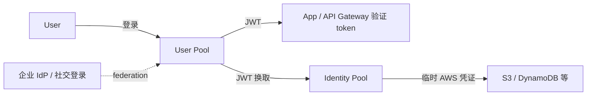

## Definition

Amazon Cognito 是面向 Web 和移动应用的身份平台：它既是用户目录、认证服务器，也是 OAuth 2.0 access token 和 AWS 凭证的授权服务。它有两个独立的组件，容易混淆。

## Key Terms

| 中文 | English | 含义 |
| --- | --- | --- |
| 用户池 | User Pool | 用户目录，基于 OIDC 标准认证用户并签发 JWT |
| 身份池 | Identity Pool | 把可信 token 换成临时、受限的 AWS 凭证 |
| 联合身份 | Federation | 通过社交账号或企业 SAML/OIDC IdP 登录 |
| 身份提供商 | Identity Provider（IdP） | 负责认证用户并签发 token 的系统，见 [[Identity Provider]] |
| 临时凭证 | Temporary Credentials | 身份池签发的有时效、权限受限的 AWS 凭证 |
| 访客访问 | Guest Access | 身份池可以不要求 token，为未登录用户签发受限凭证 |

## Two Components, Two Questions

| Component | 回答的问题 | Role |
| --- | --- | --- |
| User Pool | 这个用户是谁？（认证） | User directory、OAuth 2.0/OIDC、sign-up/sign-in、tokens、federation |
| Identity Pool | 这个用户能访问哪些 AWS 资源？（授权） | 把可信身份交换成临时 AWS credentials |

两个组件互不依赖：用户池可以单独给你自己的后端签发 token，身份池也可以为你已有的身份提供商换取凭证。需要同时让用户登录并直接访问 AWS 资源时，才一起使用。

## In an Enterprise Flow

Cognito User Pool 可以直接管理用户，也可以 federate 到 enterprise IdP，例如 [[Microsoft Entra ID]] 或其他 SAML/OIDC provider，再签发 Cognito tokens 给应用。

如果企业已批准 iSAM/Entra 作为 issuer，且 [[AWS API Gateway]] 能直接信任相关 token，则不一定需要再引入 Cognito。部署在 AWS 本身并不构成采用 Cognito 的理由。

## Gotchas

- User Pool token 与 Identity Pool AWS credentials 是不同东西。
- 增加 federation/broker 会增加 issuer、claim mapping、logout 和 troubleshooting 复杂度。
- 引入 Cognito 前应明确它解决的是 user directory、federation、token normalization，还是 AWS credential vending。
- API Gateway 的 REST API 用 Cognito user pool authorizer，HTTP API 用 JWT authorizer 验证 user pool token，见 [[AWS API Gateway]]。

## Connections

- [[Identity Provider]]
- [[OAuth 2.0]]
- [[OpenID Connect]]
- [[AWS API Gateway]]
- [[AWS IAM]]

## Sources

- [What is Amazon Cognito](https://docs.aws.amazon.com/cognito/latest/developerguide/what-is-amazon-cognito.html)
- [Control access to REST APIs using Cognito user pools as an authorizer](https://docs.aws.amazon.com/apigateway/latest/developerguide/apigateway-integrate-with-cognito.html)
