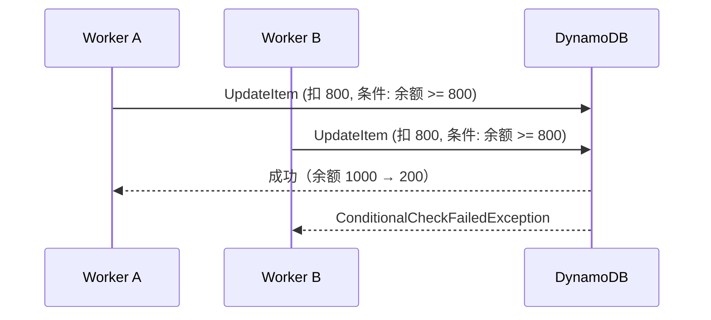

## Definition

Amazon DynamoDB 是 AWS 托管的分布式 NoSQL 数据库，使用 partition key 和可选 sort key 组织 Item，并提供条件写入和事务能力。

## Key Terms

| 中文 | English | 含义 |
| --- | --- | --- |
| 项 | Item | 表中的一条记录，由主键唯一标识 |
| 分区键 / 排序键 | Partition Key / Sort Key | 主键可以只有分区键，也可以是分区键加排序键 |
| 条件写入 | Conditional Write | 写入只在条件表达式成立时才执行 |
| 条件表达式 | Condition Expression | 描述写入前提条件的表达式，例如 `availableCash >= :amount` |
| 事务 | Transaction | `TransactWriteItems` / `TransactGetItems` 把多个动作组成 all-or-nothing 操作 |
| 客户端令牌 | Client Token | 让 `TransactWriteItems` 变成幂等调用的令牌 |
| 强一致读 / 最终一致读 | Strongly / Eventually Consistent Read | 前者返回最新已确认写入，后者可能读到旧值，是默认方式 |
| 流 | DynamoDB Streams | 记录表中 item 变化的有序日志，保留 24 小时 |
| 热分区 | Hot Partition | 流量集中在少数 partition key 上，触及单分区吞吐上限 |
| 全局表 | Global Tables | 跨 Region 复制的多活表 |

## Conditional Write

单个 Item 的 `UpdateItem` 可以同时检查条件并执行修改：

```python
table.update_item(
    Key={"accountId": "123"},
    UpdateExpression="SET availableCash = availableCash - :amount",
    ConditionExpression="availableCash >= :amount",
    ExpressionAttributeValues={":amount": 800},
)
```

条件判断和更新由 DynamoDB 作为一个原子操作协调，因此适合实现单 Item 上的 [[Data Invariant|不变量]]。条件不成立时，请求失败并返回 `ConditionalCheckFailedException`，应用据此决定拒绝或重试。



## Transactions

`TransactWriteItems` 是同步、可选幂等的写操作，把最多 100 个写动作组成 all-or-nothing 事务：

- 动作可以跨一个或多个表，但必须在同一个 AWS account 和同一个 Region 中。
- 事务中 item 的总大小不能超过 4 MB。
- 事务操作之间是 serializable isolation。
- 可以带 client token 保证幂等：同一个 token 在请求完成后 10 分钟内重复提交会成功返回且不再修改数据；窗口内更改了其他参数会返回 `IdempotentParameterMismatch`；超过 10 分钟被视为新请求。
- 事务本身仍需考虑冲突和超时。

## Read Consistency

- 表和 LSI 的读取默认是最终一致，可以选择强一致读；GSI 和 Streams 的读取始终是最终一致。
- DynamoDB 提供 read-committed 隔离：读取总是返回已提交的值，但不阻止读取之后立刻发生的修改。

## Streams

DynamoDB Streams 可以把 Item 变化交给下游消费者。每条 stream record 在流中只出现一次，对同一个 item 的修改按实际顺序出现，记录保留 24 小时。

事务完成后，修改会逐步传播到 GSI、Streams 和备份：同一事务的 stream records 可能在不同时间出现，并与其他事务的记录交错。消费者不能假设事务在 Stream 中是原子的或有顺序保证；需要事务一致的快照时，用 `TransactGetItems` 一起读取。

## Scaling Risks

- 每个 partition 最多提供 3,000 读单位/秒和 1,000 写单位/秒，partition key 设计不均会形成 Hot Partition。
- 增加 Worker 并发可能导致 throttling。
- 全局表需要单独分析冲突、一致性和 [[Recovery Point Objective|RPO]]：
  - 默认的 MREC 模式异步复制，通常在一秒内完成；同一个 item 的并发写入以最新内部时间戳为准（last writer wins）。
  - MRSC 模式同步复制，强一致读总能读到最新版本，必须部署在恰好三个 Region。

## Connections

### Correctness
- [[Atomic Operation]]
- [[Concurrency Control]]
- [[Transaction Isolation]]
- [[Optimistic Locking]]

### Patterns
- [[Transactional Outbox]]
- [[Reliable Asynchronous Processing]]

### Case study
- [[Order Processing Consistency Case Study]]

## Sources

- [DynamoDB read and write operations](https://docs.aws.amazon.com/amazondynamodb/latest/developerguide/read-write-operations.html)
- [DynamoDB transactions](https://docs.aws.amazon.com/amazondynamodb/latest/developerguide/transaction-apis.html)
- [DynamoDB read consistency](https://docs.aws.amazon.com/amazondynamodb/latest/developerguide/HowItWorks.ReadConsistency.html)
- [DynamoDB Streams](https://docs.aws.amazon.com/amazondynamodb/latest/developerguide/Streams.html)
- [Partition key design](https://docs.aws.amazon.com/amazondynamodb/latest/developerguide/bp-partition-key-design.html)
- [Global tables](https://docs.aws.amazon.com/amazondynamodb/latest/developerguide/V2globaltables_HowItWorks.html)
