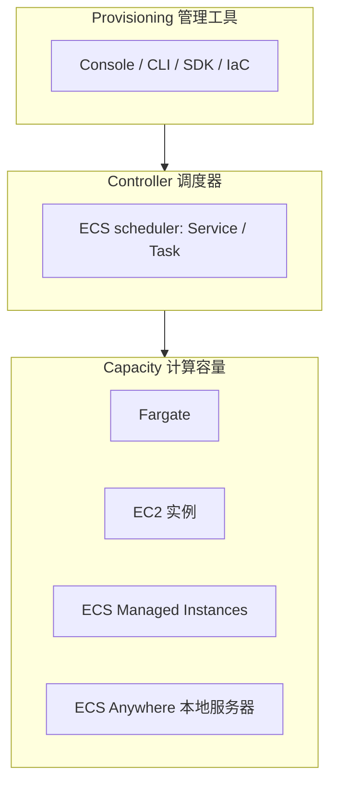
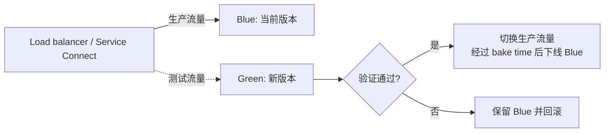

## Definition

Amazon Elastic Container Service（ECS）是 AWS 的全托管容器编排服务。它使用 Task Definition 描述容器，用 Service 维护期望数量并与负载均衡和 Auto Scaling 集成，不需要自己管理控制面。

## Key Terms

| 中文 | English | 含义 |
| --- | --- | --- |
| 任务定义 | Task Definition | 应用的蓝图：用哪些镜像、资源和配置 |
| 任务 | Task | 执行工作后就停止的应用，例如批处理作业 |
| 服务 | Service | 长期运行的无状态应用，维持期望的任务数量 |
| 集群 | Cluster | 应用运行所在的基础设施 |
| 容量 | Capacity | 容器实际运行的计算资源：Fargate、EC2、ECS Managed Instances、ECS Anywhere |
| 滚动更新 | Rolling Update | 逐步用新任务替换旧任务 |
| 蓝/绿部署 | Blue/Green Deployment | 同时运行新旧两个服务版本，验证后切换流量 |
| 金丝雀部署 | Canary Deployment | 先把一小部分流量导给新版本，通过后再切换剩余流量 |
| 烘焙时间 | Bake Time | 流量切换后新旧版本同时运行的观察期 |
| 生命周期钩子 | Lifecycle Hook | 在部署的特定阶段运行 Lambda 或暂停等待人工确认 |

## Architecture Layers

## Good Fit

- 长时间运行的 API、Worker 和后台服务。
- 需要容器运行时，但不需要 Kubernetes API 的团队。
- 希望在 AWS 上降低控制面和集群运维复杂度。
- 使用 Fargate 运行不想直接管理节点的容器任务。

## Trade-offs

- 比 [[AWS Lambda]] 更适合长期运行和自定义容器进程，但需要管理 Task、Service、网络和扩缩容策略。
- 相比 [[Amazon EKS]]，平台抽象更 AWS-specific，但运维面通常更小。
- 增加 ECS Task 数量之前仍需检查数据库和外部依赖容量。

## Deployment

ECS 支持几种部署方式：

- **Rolling update**：服务调度器用新任务逐步替换正在运行的任务，替换节奏由 `minimumHealthyPercent` 等参数控制。见 [[Rolling Deployment]]。
- **ECS blue/green**：AWS 现在推荐使用 ECS 自带的蓝绿部署。新旧两个服务版本同时运行，先用测试流量验证，再把生产流量切到新版本；有 bake time 和 lifecycle hook，出问题可以快速回到旧版本。部署期间资源用量可能翻倍；对没有负载均衡、Service Connect 或 VPC Lattice 的 headless 服务，ECS 只替换任务，不管理流量切换。见 [[Blue-Green Deployment]]。
- **ECS canary**：流量分两阶段切换，先切到 canary 比例，经过 canary bake time 后再一次性切完剩余流量。见 [[Canary Deployment]]。
- **CodeDeploy blue/green**：由 CodeDeploy 控制的较早方式，提供预定义的 Canary、Linear（等量分步）和 All-at-once 三种流量切换。官方文档建议优先使用 ECS 自带的蓝绿部署。

## Connections

### Compared in
- [[AWS Compute Options]]

### Related concepts
- [[Containerization]]
- [[Canary Deployment]]
- [[Scalability]]

## Sources

- [What is Amazon ECS](https://docs.aws.amazon.com/AmazonECS/latest/developerguide/Welcome.html)
- [Amazon ECS blue/green deployments](https://docs.aws.amazon.com/AmazonECS/latest/developerguide/deployment-type-blue-green.html)
- [Amazon ECS canary deployments](https://docs.aws.amazon.com/AmazonECS/latest/developerguide/canary-deployment.html)
- [CodeDeploy blue/green deployments for Amazon ECS](https://docs.aws.amazon.com/AmazonECS/latest/developerguide/deployment-type-bluegreen.html)
- [Deploy Amazon ECS services by replacing tasks (rolling update)](https://docs.aws.amazon.com/AmazonECS/latest/developerguide/deployment-type-ecs.html)
