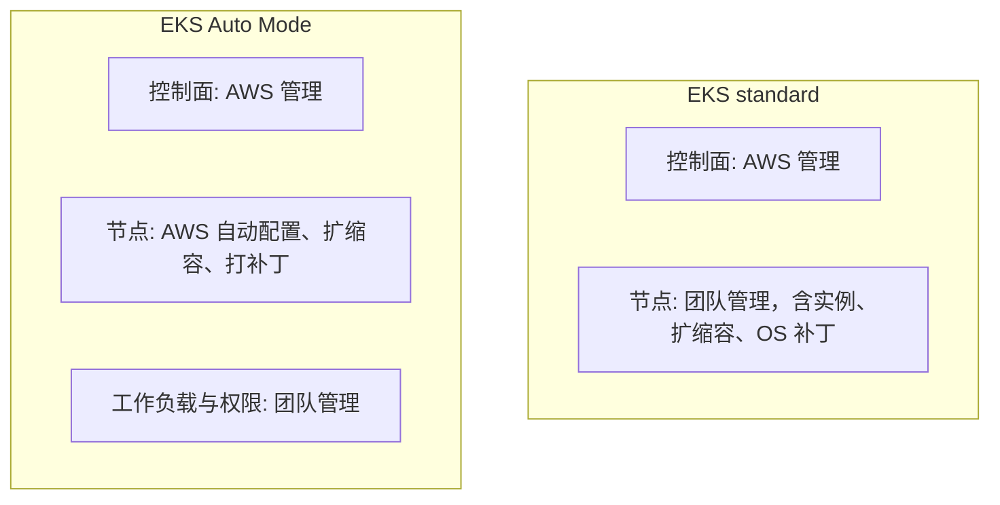

## Definition

Amazon Elastic Kubernetes Service（EKS）是 AWS 托管的 [[Kubernetes]] 服务。AWS 管理托管控制面的可用性和生命周期；是否由 AWS 继续管理节点，取决于使用 EKS standard 还是 EKS Auto Mode。团队仍需设计工作负载、网络、权限、升级和平台运维。

## Key Terms

| 中文 | English | 含义 |
| --- | --- | --- |
| 控制面 | Control Plane | 调度工作负载、管理节点、存储集群状态的组件 |
| 数据面 / 节点 | Data Plane / Nodes | 实际运行 Pod 的计算资源 |
| 标准模式 | EKS standard | AWS 管理控制面，节点由用户管理 |
| 自动模式 | EKS Auto Mode | EKS 同时管理节点：自动配置基础设施、选择实例、扩缩容、打补丁 |
| EKS 能力 | EKS Capabilities | 全托管的集群服务，如 Argo CD、ACK、kro |
| 混合节点 | EKS Hybrid Nodes / EKS Anywhere | 在自己的数据中心运行 Kubernetes 节点 |

## Who Manages What

两种模式下，应用本身的设计、权限和升级都仍然是团队的责任。

## When It Is a Fit

- 团队明确需要 Kubernetes API、生态或组织级开发平台。
- 多团队需要统一的部署、策略、服务发现和资源治理。
- 工作负载需要 Kubernetes 的调度和扩展模型。
- 团队已经具备足够的平台运维能力。

## What It Does Not Mean

- 使用 EKS 不会自动让应用高可用或可扩展。
- 没有固定用户数、QPS 或微服务数量门槛。
- 托管控制面不等于所有数据面、Add-on 和应用升级都由 AWS 负责；Auto Mode 会接管节点管理，但应用层面仍由团队负责。
- EKS 的访问控制同时依赖 Kubernetes 和 [[AWS IAM]]。

## Connections

### Implements
- [[Kubernetes]]

### Compared in
- [[AWS Compute Options]]

### Related deployment
- [[Canary Deployment]]

## Sources

- [What is Amazon EKS](https://docs.aws.amazon.com/eks/latest/userguide/what-is-eks.html)
