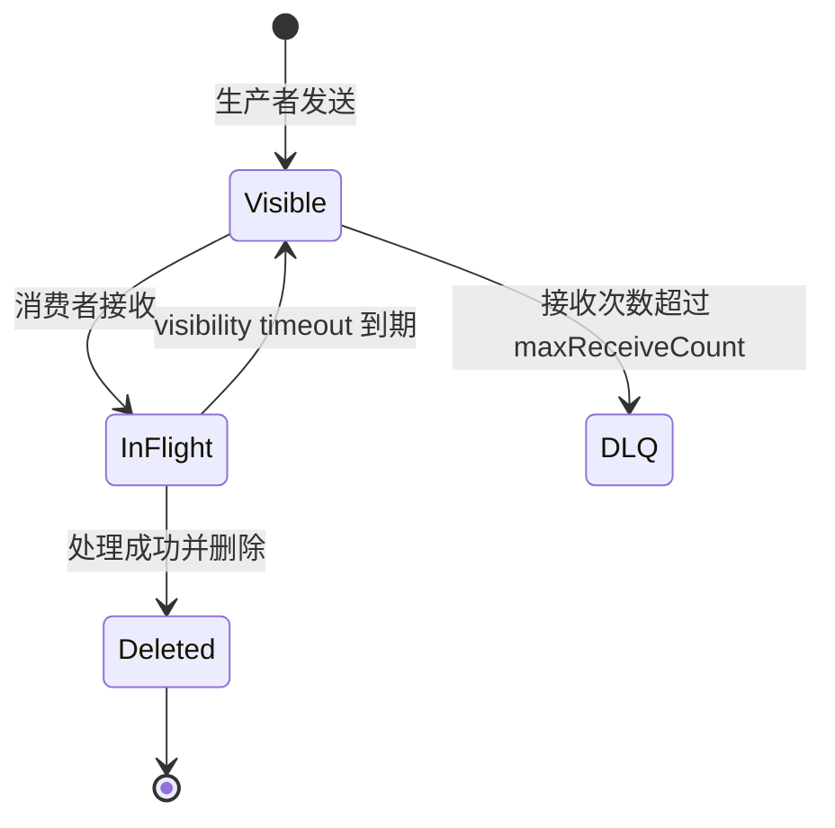
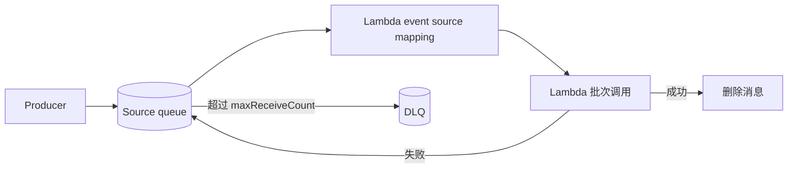

## Definition

Amazon Simple Queue Service（SQS）是 AWS 托管的消息队列服务，用于解耦生产者和消费者、缓冲突发负载并隔离消费者暂时故障。

## Key Terms

| 中文 | English | 含义 |
| --- | --- | --- |
| 标准队列 | Standard Queue | 默认类型，至少一次投递，可能重复，也可能乱序 |
| FIFO 队列 | FIFO Queue | 在消息组内保序，并支持发送端去重 |
| 可见性超时 | Visibility Timeout | 消息被接收后对其他消费者暂时不可见的时间，默认 30 秒 |
| 在途消息 | In-flight Message | 已被消费者接收但尚未删除的消息 |
| 消息组 | Message Group（Group ID） | FIFO 队列中保序的单位，同一组内的消息按序投递 |
| 去重 | Deduplication | FIFO 队列在 5 分钟去重窗口内不会收下重复发送的消息 |
| 死信队列 | Dead-Letter Queue（DLQ） | 收容多次处理失败的消息的队列 |
| 重驱动策略 | Redrive Policy | 配置 DLQ 和 `maxReceiveCount` 的策略 |
| 最大接收次数 | `maxReceiveCount` | 消息被接收多少次后移入 DLQ |
| 长轮询 | Long Polling | 接收请求查询所有服务器，至少有一条消息可返回时才响应；默认的短轮询只查询部分服务器并立即返回 |
| 部分批次响应 | Partial Batch Response | 只让失败消息重新可见，见下文 Lambda 集成 |

## Standard and FIFO

- Standard Queue 提供 at-least-once delivery，消息可能重复和乱序，但会尽力保持发送顺序。SQS 在确认之前把消息冗余存储到多个可用区。
- FIFO Queue 在同一个 message group 内保序；在 5 分钟去重窗口内重复发送同一条消息，SQS 不会把重复消息放进队列。去重靠 content-based deduplication（对消息体做 SHA-256，不含属性），或显式提供 deduplication ID。
- FIFO 的去重只解决发送端重复。消费者在 visibility timeout 到期后仍会重新收到消息，因此不能替代端到端 [[Idempotency|业务幂等]]。

## Message Lifecycle and Visibility Timeout

消费者收到消息后，消息仍在队列中，但在 visibility timeout 内对其他消费者暂时不可见：

- 成功处理后删除消息（手动 `DeleteMessage`，部分 SDK 支持自动删除）。
- Worker 崩溃或未删除时，timeout 后消息重新可见。
- 处理时间较长时，可以用 `ChangeMessageVisibility` 延长超时。
- 因为 at-least-once 语义，不能假设 timeout 内绝对不会重复投递。
- Standard 队列的在途消息上限约为 120,000。

## Lambda Integration

[[AWS Lambda]] 使用 event source mapping 轮询 SQS，并以批次同步调用函数：

- 成功批次由 Lambda 删除消息。
- 默认情况下批次失败会让整个批次在 timeout 后重新可见。
- 开启 `ReportBatchItemFailures` 后，函数返回 `batchItemFailures`，只有失败的消息会被重试。函数如果抛出异常，整个批次仍被视为失败。
- 函数 timeout 必须小于或等于队列的 visibility timeout，AWS 建议把 visibility timeout 设为函数 timeout 的 6 倍以上。
- 消费者必须能安全处理重复消息。

扩缩容与背压：

- Standard 队列：Lambda 起始并发 5 个批次，之后每分钟最多增加 300 个并发调用，单个 event source mapping 最大 1,250 个并发调用。
- FIFO 队列：同一 message group 的消息按序交给函数，函数报错时，会先对受影响的消息重试完，再取该组的新消息。
- **Maximum concurrency** 是事件源级别的设置，限制某个队列最多能调用多少个函数实例，避免一个队列耗尽函数的预留并发或账号配额。它与函数的 reserved concurrency 是两个独立设置，不要把前者设得高于后者，否则消息可能被限流。
- **Provisioned mode** 使用专用 poller，扩容更快，但不能与 maximum concurrency 同时使用。

## DLQ

[[Dead Letter Queue]] 的转移由 redrive policy 和 `maxReceiveCount` 控制。它统计 receive count，而不是简单等价于“业务代码失败次数”。AWS 建议 Lambda + SQS 把源队列的 `maxReceiveCount` 设为至少 5，让 Lambda 有几次重试机会，避免因限流就把消息送进 DLQ。DLQ 必须与源队列在同一个账号和 Region；需要严格保序的 FIFO 队列不建议使用 DLQ，否则会打乱顺序。

## Backpressure and Observability

重点监控：

- ApproximateNumberOfMessagesVisible
- ApproximateAgeOfOldestMessage
- Worker errors、throttles 和并发
- DLQ message count
- 下游数据库与 API 容量

盲目增加 Worker 并发可能把下游压垮。

## Connections

### Implements
- [[Message Queue]]
- [[Delivery Semantics]]
- [[Reliable Asynchronous Processing]]

### Failure handling
- [[Retry]]
- [[Dead Letter Queue]]

### Operations
- [[Observability]]

## Sources

- [What is Amazon SQS](https://docs.aws.amazon.com/AWSSimpleQueueService/latest/SQSDeveloperGuide/welcome.html)
- [SQS standard queues](https://docs.aws.amazon.com/AWSSimpleQueueService/latest/SQSDeveloperGuide/standard-queues.html)
- [Exactly-once processing in SQS](https://docs.aws.amazon.com/AWSSimpleQueueService/latest/SQSDeveloperGuide/FIFO-queues-exactly-once-processing.html)
- [SQS visibility timeout](https://docs.aws.amazon.com/AWSSimpleQueueService/latest/SQSDeveloperGuide/sqs-visibility-timeout.html)
- [Using dead-letter queues in SQS](https://docs.aws.amazon.com/AWSSimpleQueueService/latest/SQSDeveloperGuide/sqs-dead-letter-queues.html)
- [Using Lambda with Amazon SQS](https://docs.aws.amazon.com/lambda/latest/dg/with-sqs.html)
- [Configuring an SQS event source for Lambda](https://docs.aws.amazon.com/lambda/latest/dg/services-sqs-configure.html)
- [Handling errors for an SQS event source](https://docs.aws.amazon.com/lambda/latest/dg/services-sqs-errorhandling.html)
- [Configuring scaling behavior for SQS event source mappings](https://docs.aws.amazon.com/lambda/latest/dg/services-sqs-scaling.html)
