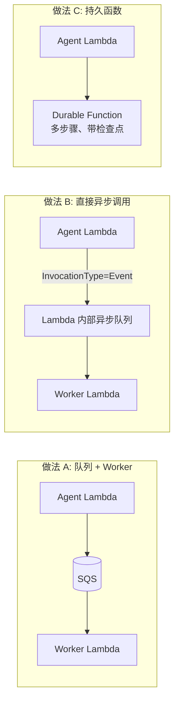

## Purpose

一个常见场景：前端提交一个耗时任务，后端不能让请求一直等着，需要把任务交给后台处理，前端再查询结果。本文比较在 AWS 上用 Lambda 实现这类异步任务的几种做法，帮助判断什么时候该用哪一种。

## Key Terms

| 中文 | English | 含义 |
| --- | --- | --- |
| 异步调用 | Asynchronous Invocation | 调用 Lambda 时不等结果，Lambda 把事件排进自己的队列 |
| 事件源映射 | Event Source Mapping（ESM） | Lambda 轮询 SQS 等队列并批量调用函数 |
| 背压 | Backpressure | 消费者跟不上时，用队列缓冲并限制消费并发 |
| 死信队列 | Dead-Letter Queue（DLQ） | 收容多次失败的消息 |
| 轮询 | Polling | 前端定期查询任务状态 |
| 作业状态 | Job Status | 保存在存储里的任务进度和结果，用任务 ID 查询 |
| 持久函数 | Durable Function | 带检查点、可暂停恢复的多步骤 Lambda 函数 |

## Three Ways to Hand Work to a Lambda

三者里，前端想拿到结果，都需要一个独立的办法（见后文），因为异步调用和队列都不会把函数结果返回给提交者。

## Comparison

| 维度 | A. SQS + Worker（事件源映射） | B. 直接异步调用 | C. Durable Function |
| --- | --- | --- | --- |
| 缓冲 | 持久队列，可见消息数和最老消息年龄可监控 | Lambda 管理的内部队列 | 由 Lambda 管理的持久执行 |
| 重试 | visibility timeout 到期后重新可见，次数由 `maxReceiveCount` 控制 | 函数出错默认重试两次（间隔 1、2 分钟），限流和系统错误最长重试 6 小时 | 步骤内置重试和检查点 |
| 失败隔离 | DLQ 加 redrive 策略，可按消息重放 | DLQ 或 on-failure destination，只保存被丢弃的事件 | 自动从检查点恢复 |
| 并发控制 | 事件源级别的 maximum concurrency，保护下游 | 受函数并发限制，被限流时会重试 | 取决于函数并发 |
| 批处理 | 支持批量，部分批次响应只重试失败消息 | 一次一个事件 | 不适用 |
| 顺序 | FIFO 队列在 message group 内保序 | 不保证 | 单次执行内由代码顺序决定 |
| payload | 取决于 SQS 消息大小 | 1 MB | 取决于执行 |
| 最长时长 | 函数 timeout（默认计算 15 分钟；visibility timeout 需至少为其 6 倍） | 函数 timeout | 整个流程最长一年，等待不计算费用 |
| 复杂度 | 多一个队列和 ESM 配置 | 最少的组件 | 需要使用 durable execution SDK |
| 重复 | 至少一次，需要幂等 | 也可能重复，需要幂等 | 步骤需要考虑重放 |

## When Each Fits

- **A. SQS + Worker**：需要削峰、限制并发以保护数据库或外部 API、按消息重试和 DLQ 重放、保序，或者想直接监控积压和消息年龄。
- **B. 直接异步调用**：任务少而独立，不需要对队列做精细控制，希望少一个组件。要接受重试次数和间隔固定、队列由 Lambda 管理、payload 上限 1 MB 的限制。
- **C. Durable Function**：一个任务包含多个步骤（例如多次模型调用、等待人工确认、轮询外部系统），需要失败后从中间继续，而不是整个重来。

改成直接异步调用并不会自动“更好”：它减少了组件，同时也放弃了 SQS 提供的并发控制、DLQ 重放和积压监控。如果现有方案在这些方面有价值，就不应该为了简化而换掉。

## Polling Is a Separate Question

前端一直轮询，是“怎么把结果交给提交者”的问题，与后端用 SQS 还是异步调用无关：

- **轮询 + 作业状态**：提交时返回任务 ID，Worker 把进度和结果写入存储，前端按任务 ID 查询。实现简单、可靠，代价是延迟和空查询。优化方向是合理的轮询间隔（例如逐步拉长）和轻量的状态查询接口。
- **推送**：[[AWS API Gateway]] 支持 WebSocket API，可以在任务完成时主动通知前端，省去轮询。代价是要管理连接。
- **流式响应**：如果任务本身是逐步产出内容（例如流式输出），Lambda 的 response streaming 可以通过 function URL 或 API Gateway 代理集成把部分结果持续发给客户端，响应最大 200 MB，当前支持 Node.js 托管运行时。注意：即使客户端断开，流式响应也不会被中断，会按完整执行时长计费。它需要保持一个同步连接，因此适合 15 分钟以内的任务，不适合“提交后离开”的场景。

## Questions to Settle First

1. 最大瓶颈是什么：积压、重复处理、延迟、成本，还是前端轮询体验？
2. Agent Lambda 只是入队，还是还做校验、路由、鉴权？如果只是转发，可以评估能否由 API Gateway 直接调用（REST API 非代理集成支持以 `Event` 方式异步调用 Lambda）。
3. 任务是否需要保序、限并发、按消息重放？
4. 单次任务时长和结果大小多大？
5. 是否已经有幂等设计？无论选哪种做法，重复投递都是可能的。

## Connections

### Services
- [[AWS Lambda]]
- [[Amazon SQS]]
- [[AWS API Gateway]]

### Concepts
- [[Reliable Asynchronous Processing]]
- [[Idempotency]]
- [[Observability]]
- [[Dead Letter Queue]]

## Sources

- [Invoking a Lambda function asynchronously](https://docs.aws.amazon.com/lambda/latest/dg/invocation-async.html)
- [How Lambda handles errors and retries with asynchronous invocation](https://docs.aws.amazon.com/lambda/latest/dg/invocation-async-error-handling.html)
- [Using Lambda with Amazon SQS](https://docs.aws.amazon.com/lambda/latest/dg/with-sqs.html)
- [Configuring an SQS event source for Lambda](https://docs.aws.amazon.com/lambda/latest/dg/services-sqs-configure.html)
- [Lambda durable functions](https://docs.aws.amazon.com/lambda/latest/dg/durable-functions.html)
- [Response streaming for Lambda functions](https://docs.aws.amazon.com/lambda/latest/dg/configuration-response-streaming.html)
- [Set up asynchronous invocation of the backend Lambda function (API Gateway)](https://docs.aws.amazon.com/apigateway/latest/developerguide/set-up-lambda-integration-async.html)
