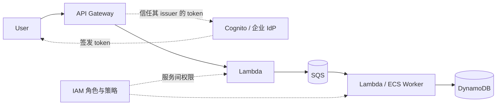

按服务分组:概念写在服务笔记里,跨服务选型使用比较页,踩坑用 `type: problem` 记录。盲区见 [[AWS Gaps]]。

## Service Map

下图展示这些服务在一条典型请求链路上的位置：

## Notes

### Compute

- [[AWS Compute Options]]
- [[AWS Lambda]]
- [[Amazon ECS]]
- [[Amazon EKS]]

### Messaging and Data

- [[Amazon SQS]]
- [[Amazon DynamoDB]]

### API and Identity

- [[AWS API Gateway]]
- [[Amazon Cognito]]
- [[AWS IAM]]
- [[CS Area (计算机)/Software Engineering/API Design/index|API Identity and Gateway MOC]]

### Related Concepts

- [[Reliable Asynchronous Processing]]
- [[Scalability]]
- [[High Availability]]
