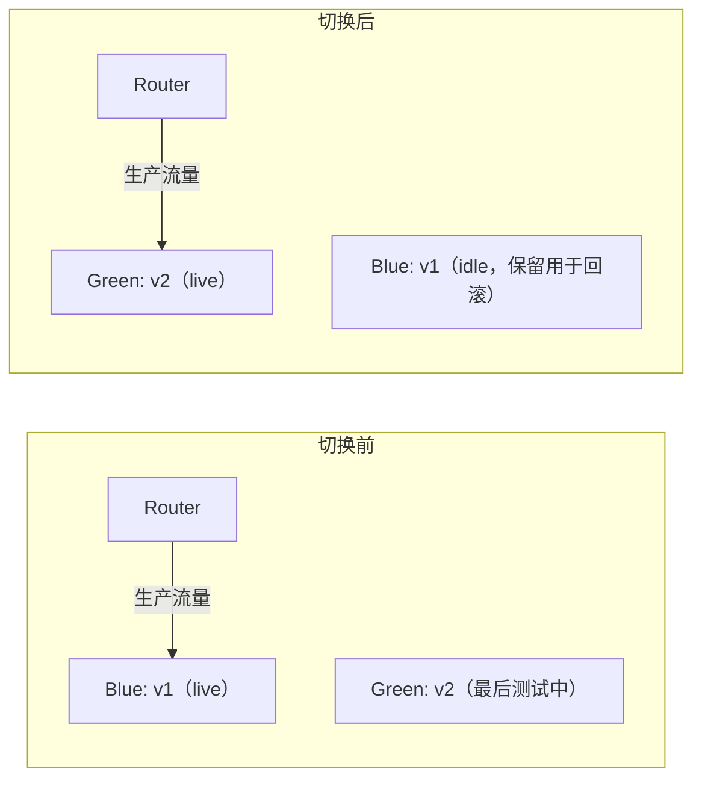

## Definition

Blue-Green Deployment 同时维护当前生产环境和完整的新版本环境，在新环境验证完成后切换生产流量。

## Key Terms

| 中文 | English | 含义 |
| --- | --- | --- |
| 蓝绿部署 | Blue-Green Deployment | 两套尽量相同的生产环境，通过切换路由上线新版本 |
| 蓝 / 绿环境 | Blue / Green Environment | 当前生产环境 / 新版本环境 |
| 切换 | Cutover | 把生产流量从一套环境切到另一套 |
| 回滚 | Rollback | 把流量切回旧环境 |
| 路由器 | Router | 决定请求去哪套环境的组件，如负载均衡器 |
| 烘焙时间 | Bake Time | 切换后新旧环境同时保留、观察的时间（ECS 术语） |

## How It Works

Martin Fowler 的描述：保证有两套尽量一致的生产环境，任一时刻只有一套（比如蓝）在线；新版本先在另一套（绿）里做最后测试，通过后把路由切到绿，蓝就空闲下来。出问题时，把路由切回蓝即可快速回滚。

## Strengths

- 流量切换和应用回滚相对直接。
- 可以在切换前对新环境运行验证。
- 新旧应用环境彼此隔离。

## Trade-offs

- 需要同时维护两套容量。
- 数据库和外部副作用通常由两套环境共享，不能只靠切回流量完成回滚。Fowler 指出，绿环境在线期间的“漏掉的事务”仍是问题，可能的做法是把事务同时送给两套环境，或者在切换前先让应用进入只读模式，运行一段时间后再切回读写。
- 长连接、后台任务和缓存需要明确切换策略。

## Platforms

- [[Amazon ECS]]：AWS 现在推荐使用 ECS 自带的 blue/green 部署。新旧两个服务版本同时运行，先用测试流量验证再切换生产流量，有 bake time 和 lifecycle hook，部署期间资源用量可能翻倍。较早的做法是通过 CodeDeploy 控制。
- [[AWS Lambda]]：函数版本不可变，把 alias 一次性指向新版本就是切换，指回旧版本就是回滚。这是对官方文档的归纳，文档本身只把它与 canary 区分开。
- [[Kubernetes]]：Deployment 内置的策略只有 `RollingUpdate`（默认）和 `Recreate`，没有现成的蓝绿类型；要做蓝绿，需要自己准备两套 Deployment 并切换 Service 或网关的路由。

## Connections

### Compared with
- [[Canary Deployment]]
- [[Rolling Deployment]]

### Platforms
- [[Amazon ECS]]
- [[AWS Lambda]]
- [[Kubernetes]]

### Supports
- [[Reliability]]

## Sources

- [Martin Fowler — Blue Green Deployment](https://martinfowler.com/bliki/BlueGreenDeployment.html)
- [Amazon ECS blue/green deployments](https://docs.aws.amazon.com/AmazonECS/latest/developerguide/deployment-type-blue-green.html)
- [Lambda — Weighted alias for canary deployments](https://docs.aws.amazon.com/lambda/latest/dg/configuring-alias-routing.html)
- [Kubernetes — Deployments: strategy](https://kubernetes.io/docs/concepts/workloads/controllers/deployment/)
