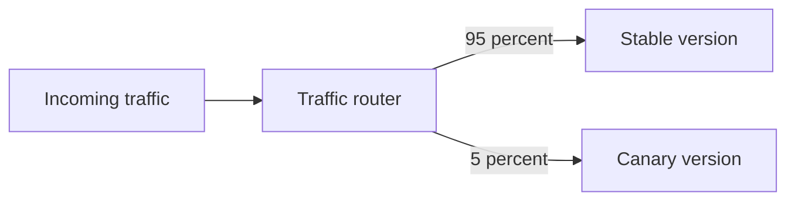
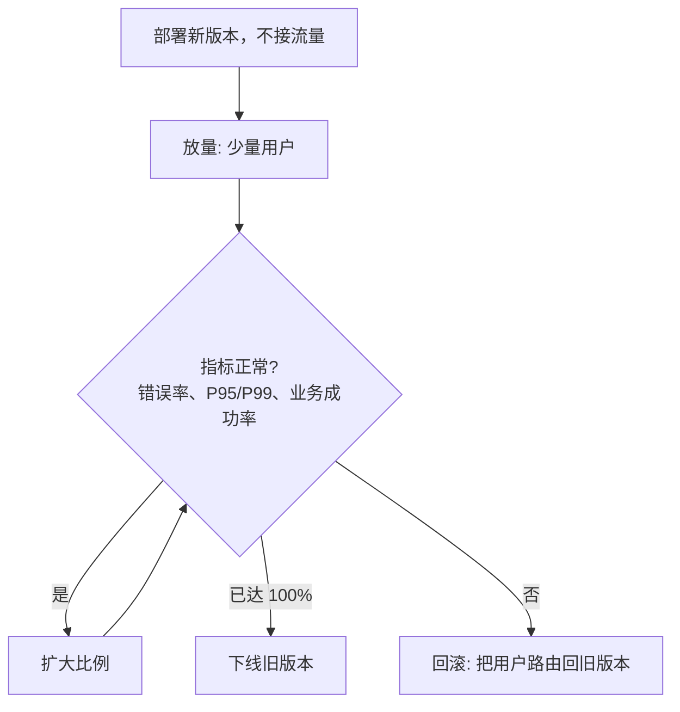

## Definition

Canary Deployment（Canary Release）把一小部分生产流量先发送到新版本，通过技术和业务指标验证后再逐步扩大流量，以控制发布故障的影响范围。

## Key Terms

| 中文 | English | 含义 |
| --- | --- | --- |
| 金丝雀发布 | Canary Deployment / Canary Release | 先让少量用户使用新版本，逐步扩大 |
| 流量路由器 | Traffic Router | 按比例或规则把流量分给新旧版本 |
| 加权路由 | Weighted Routing | 按权重在多个后端之间分配流量 |
| 观察期 | Bake Time / Evaluation Period | 每一步放量后观察指标的时间 |
| 自动回滚 | Automatic Rollback | 指标超过阈值时自动恢复旧版本 |
| 线性发布 | Linear Deployment | 按等量、等间隔分步放量 |

## How It Works

Fowler 的描述：先把新版本部署到一部分不接收用户的基础设施上；满意后开始路由少量用户过去。挑选用户的策略可以是随机抽样、先给内部员工，或者按用户画像选择。随着信心增加，再把更多服务器和用户切到新版本；发现问题时，回滚就是把用户路由回旧版本。另一个好处是可以借此做容量测试。

5% → 25% → 50% → 100% 只是示例步骤，不是固定规则。每一步都应定义观察时间、错误率、[[Latency Percentiles|P95/P99]]、业务成功率和自动回滚条件。

## Compared With

| | Canary | [[Blue-Green Deployment]] | [[Rolling Deployment]] |
| --- | --- | --- | --- |
| 做法 | 按比例逐步把流量给新版本 | 完整的新环境验证后一次切换 | 逐批替换实例 |
| 重点 | 用真实流量降低发布风险 | 切换与回滚简单 | 部署过程 |
| 成本 | 少量新版本容量 | 同时两套完整容量 | 少量额外容量 |

- **[[AB Testing]]**：流量分组可能相似，但目标通常是产品实验，而不是降低发布风险。

## Implementations

- [[AWS Lambda]]：用加权 alias 在两个已发布版本之间分流，CodeDeploy 预定义了 `LambdaCanary10Percent5Minutes` 等配置；AWS SAM 可以自动化并在 CloudWatch alarm 触发时回滚。
- [[Amazon ECS]]：有 ECS 自带的 canary 部署，流量分两阶段切换：先切到 canary 比例，经过 canary bake time 后再切完剩余流量；也可以通过 CodeDeploy 使用 Canary 或 Linear 配置。
- [[Kubernetes]]：核心的 Deployment 滚动更新是按 Pod 数量替换，不是按流量权重。要按权重分流，可以用 Gateway API 的 `HTTPRoute`，在 `backendRefs` 里为不同后端设置权重（例如 90 比 10）。Ingress、Service Mesh 或 rollout controller 也可以做到。

## Connections

### Supports
- [[Reliability]]
- [[High Availability]]

### Compared with
- [[Rolling Deployment]]
- [[Blue-Green Deployment]]

### Observed through
- [[Observability]]
- [[Tail Latency]]

## Sources

- [Martin Fowler — Canary Release](https://martinfowler.com/bliki/CanaryRelease.html)
- [Lambda — Weighted alias for canary deployments](https://docs.aws.amazon.com/lambda/latest/dg/configuring-alias-routing.html)
- [CodeDeploy deployment configurations (Lambda)](https://docs.aws.amazon.com/codedeploy/latest/userguide/deployment-configurations.html)
- [Amazon ECS canary deployments](https://docs.aws.amazon.com/AmazonECS/latest/developerguide/canary-deployment.html)
- [Kubernetes Gateway API — HTTP traffic splitting](https://gateway-api.sigs.k8s.io/guides/traffic-splitting/)
