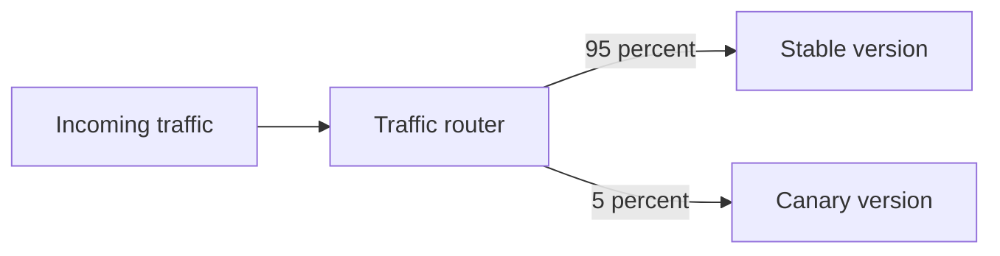

## Definition

Canary Deployment 把一小部分生产流量先发送到新版本，通过技术和业务指标验证后再逐步扩大流量，以控制发布故障的影响范围。

5% → 25% → 50% → 100% 只是示例步骤，不是固定规则。每一步都应定义观察时间、错误率、[[Latency Percentiles|P95/P99]]、业务成功率和自动回滚条件。

## Compared With

- **[[Rolling Deployment]]**：逐步替换实例，重点是部署过程。
- **[[Blue-Green Deployment]]**：同时维护完整旧环境与新环境，再切换流量。
- **[[AB Testing]]**：流量分组可能相似，但目标通常是产品实验，而不是降低发布风险。

## Implementations

- [[AWS Lambda]]：Alias weighted routing。
- [[Amazon ECS]]：Blue/green 配合 CodeDeploy 的 Canary/Linear traffic shifting。
- [[Kubernetes]]：通常使用特定 Ingress、Service Mesh 或 rollout controller；Kubernetes 核心对象本身不自动完成所有加权发布流程。

## Connections

### Supports
- [[Reliability]]
- [[High Availability]]

### Compared with
- [[Rolling Deployment]]
- [[Blue-Green Deployment]]

### Observed through
- [[Observability]]
- [[Tail Latency]]

## Sources

- [AWS Lambda weighted alias](https://docs.aws.amazon.com/lambda/latest/dg/configuring-alias-routing.html)
- [Amazon ECS blue/green deployment](https://docs.aws.amazon.com/AmazonECS/latest/developerguide/deployment-type-bluegreen.html)
