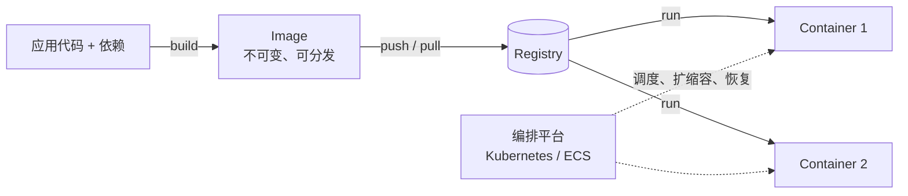

## Definition

Containerization 将应用及其运行时依赖打包成可重复部署的镜像，并通过隔离的容器进程运行。

容器解决的是打包和运行环境一致性；容器编排解决的是多个容器工作负载的部署、调度、扩缩容和恢复。

## Key Terms

| 中文 | English | 含义 |
| --- | --- | --- |
| 容器化 | Containerization | 把应用打包成镜像并以容器运行 |
| 镜像 | Container Image | 包含运行容器所需的文件、二进制、库和配置的标准化包，不可变 |
| 容器 | Container | 带着所需全部文件、相互隔离的进程 |
| 容器运行时 | Container Runtime | 实际创建和运行容器的软件 |
| 镜像仓库 | Registry | 存放和分发镜像的服务 |
| 容器编排 | Container Orchestration | 管理多个容器的部署、调度、扩缩容和恢复 |
| 开放容器倡议 | OCI（Open Container Initiative） | 制定容器格式和运行时的行业标准 |

## Image, Container, Orchestrator

Docker 文档的说明：容器就是为应用每个组件准备的隔离进程，带有它运行所需的全部文件；多个容器共享同一个内核，所以能用更少的基础设施运行更多应用。镜像是不可变的，创建后不能修改，只能创建新镜像或在其上叠加修改。云环境里容器和虚拟机常常一起使用：虚拟机上跑容器运行时，在其上运行多个容器化的应用。

OCI 目前有三份规范：Runtime Specification（怎样运行解包后的 filesystem bundle）、Image Specification（镜像格式）和 Distribution Specification（分发镜像的 API）。

## Tools and Platforms

- [[Docker]]：构建和运行容器镜像。
- [[Podman]]：无守护进程的容器工具。
- [[Kubernetes]]：管理容器化工作负载的平台。
- [[Amazon ECS]]：AWS 容器编排服务。
- [[Amazon EKS]]：AWS 托管 Kubernetes。

## Connections

### Compared in
- [[AWS Compute Options]]

### Deployment
- [[Canary Deployment]]
- [[Rolling Deployment]]
- [[Blue-Green Deployment]]

## Sources

- [Docker — What is a container?](https://docs.docker.com/get-started/docker-concepts/the-basics/what-is-a-container/)
- [Docker — What is an image?](https://docs.docker.com/get-started/docker-concepts/the-basics/what-is-an-image/)
- [Open Container Initiative — Overview](https://opencontainers.org/about/overview/)
