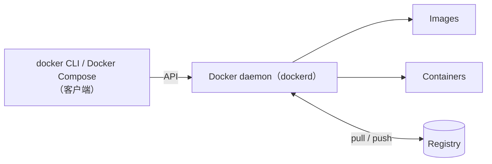

## Definition

Docker 提供构建、分发和运行容器镜像的工具与运行时，让应用在一个松散隔离的环境（容器）里打包和运行。

## Key Terms

| 中文 | English | 含义 |
| --- | --- | --- |
| 镜像 | Image | 创建容器的只读模板 |
| 容器 | Container | 镜像的运行实例 |
| Docker 守护进程 | Docker Daemon（`dockerd`） | 管理镜像和容器的后台服务 |
| Docker 客户端 | Docker Client（`docker`） | 向守护进程发命令的命令行工具 |
| Compose 文件 | Compose File（`compose.yaml`） | 声明多容器应用的服务、网络和卷 |
| 默认网络 | Default Network | Compose 为应用创建的网络，服务可用服务名互相访问 |
| 服务名解析 | Service Name DNS | 同一网络里按服务名解析容器地址 |

## Architecture

## Docker Compose

Docker Compose 用声明式的 `compose.yaml` 在一个文件里定义多个相互依赖的容器服务，并用 Compose CLI 创建和启动全部服务。

- 默认情况下，Compose 为应用创建一个 bridge 网络（名为 `<项目名>_default`），所有服务加入其中，并按服务名通过内置 DNS 互相发现，例如 reverse proxy 通过 `app:8000` 访问应用容器。
- Compose 的定义可以在开发、CI、staging 和 production 复用。Docker 文档说最简单的上线方式是在单个服务器上运行；需要扩展时，可以在 Swarm 集群上运行 Compose 应用。
- 用于生产时通常要调整配置：去掉把代码绑定进容器的 volume、改端口绑定、调整环境变量、设置 `restart: always` 之类的重启策略。

Compose 负责启动和连接容器，但不自动提供跨节点调度、复杂故障恢复或多主机平台治理，这些需要 [[Kubernetes]] 或 [[Amazon ECS]] 之类的编排平台。

## Connections

### Broader concept
- [[Containerization]]

### Orchestration alternatives
- [[Amazon ECS]]
- [[Kubernetes]]

### Deployment
- [[Rolling Deployment]]
- [[Blue-Green Deployment]]

## Sources

- [Docker overview](https://docs.docker.com/get-started/docker-overview/)
- [How Compose works](https://docs.docker.com/compose/intro/compose-application-model/)
- [Networking in Compose](https://docs.docker.com/compose/how-tos/networking/)
- [Use Compose in production](https://docs.docker.com/compose/how-tos/production/)
