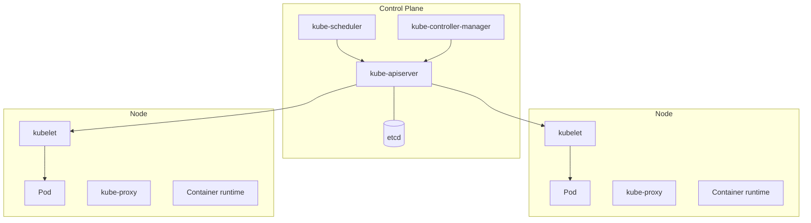

## Definition

Kubernetes 是用于管理容器化工作负载和服务的可移植、可扩展开源平台，提供声明式配置和自动化控制循环。它源自 Google 十多年运行生产负载的经验，2014 年开源；“K8s” 是 K 和 s 之间数 8 个字母的缩写。

## Key Terms

| 中文 | English | 含义 |
| --- | --- | --- |
| 集群 | Cluster | 控制面加一个或多个工作节点 |
| 控制面 | Control Plane | 管理整个集群状态的组件 |
| 节点 | Node | 运行 Pod 的工作机器 |
| Pod | Pod | 最小的部署单元，包含一个或多个容器 |
| 部署 | Deployment | 声明期望的 Pod 数量，由控制器维持 |
| 服务 | Service | 为一组 Pod 提供稳定的访问入口和负载均衡 |
| 声明式配置 | Declarative Configuration | 描述期望状态，由系统收敛到该状态 |
| 控制循环 | Control Loop / Controller | 不断比较实际与期望状态并纠正 |
| 容器运行时 | Container Runtime | 实际运行容器的软件 |

## Architecture

- **kube-apiserver**：暴露 Kubernetes HTTP API 的核心组件。
- **etcd**：保存 API server 全部数据的一致、高可用键值存储。
- **kube-scheduler**：给尚未绑定节点的 Pod 选择合适的节点。
- **kube-controller-manager**：运行各种控制器，实现 Kubernetes API 的行为。
- **kubelet**：确保 Pod（及其容器）在节点上运行。
- **kube-proxy**（可选）：维护节点上的网络规则，实现 Service。

## Core Responsibilities

- 调度 Pod 到 Node。
- 通过 Deployment 等控制器维持期望状态。
- Service discovery 和 load balancing。
- Rollout、rollback 和自愈。
- 资源约束、自动扩缩容和配置管理。

官方概述把它提供的能力归纳为：服务发现和负载均衡、存储编排、自动发布与回滚、自愈、密钥与配置管理等；并且指出 Kubernetes 可以方便地管理 canary 部署。

## When to Consider It

是否使用 Kubernetes 没有固定用户数、QPS 或微服务数量门槛。更重要的问题是：

- 是否需要统一的容器平台和 Kubernetes API？
- 多团队是否需要共同的部署、策略和权限模型？
- 是否有复杂调度、流量控制或扩展需求？
- 团队是否能承担集群、Add-on、升级和故障处理复杂度？

如果 [[AWS Lambda]] 或 [[Amazon ECS]] 已满足可靠性、成本和开发效率，不需要仅因为流量增长就迁移 Kubernetes。

## What It Does Not Provide Automatically

- 应用级 [[Consistency]] 和 [[Idempotency]]。
- 数据库高可用与备份。
- 完整的 logging、tracing 和 alerting 方案。
- 正确的容量模型和下游保护。

## Connections

### AWS implementation
- [[Amazon EKS]]

### Broader concept
- [[Containerization]]

### Deployment
- [[Canary Deployment]]
- [[Rolling Deployment]]
- [[Blue-Green Deployment]]

### Compared in
- [[AWS Compute Options]]

## Sources

- [Kubernetes — Overview](https://kubernetes.io/docs/concepts/overview/)
- [Kubernetes — Components](https://kubernetes.io/docs/concepts/overview/components/)
- [Kubernetes — Deployments](https://kubernetes.io/docs/concepts/workloads/controllers/deployment/)
- [Kubernetes Concepts](https://kubernetes.io/docs/concepts/index.html)
