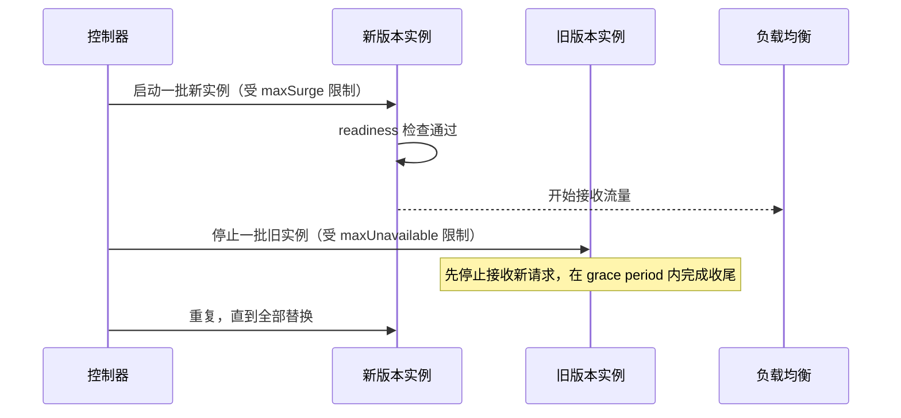

## Definition

Rolling Deployment 分批启动新版本实例，并在新实例通过 readiness 检查后逐步停止旧版本实例。

## Key Terms

| 中文 | English | 含义 |
| --- | --- | --- |
| 滚动更新 | Rolling Update | 逐批用新实例替换旧实例 |
| 就绪探针 | Readiness Probe | 判断容器能否接收流量；失败时从 Service 的端点中摘除 |
| 存活探针 | Liveness Probe | 判断容器是否还活着，失败时重启 |
| 启动探针 | Startup Probe | 判断应用是否已完成启动 |
| 最大不可用 | `maxUnavailable` | 更新期间允许不可用的 Pod 数量或比例 |
| 最大激增 | `maxSurge` | 更新期间允许超出期望数量的 Pod 数量或比例 |
| 优雅终止 | Graceful Termination | 给进程时间完成收尾再被强制终止 |
| 连接排空 | Connection Draining | 停止接收新连接，等待已有请求完成 |
| 进度截止时间 | `progressDeadlineSeconds` | Deployment 进度停滞多久后被报告为失败 |

## How It Works

## Kubernetes Details

- Deployment 的 `.spec.strategy.type` 可以是 `RollingUpdate`（默认）或 `Recreate`。`Recreate` 会先终止所有旧 Pod 再创建新 Pod，会有停机。
- `RollingUpdate` 的默认值是 `maxUnavailable` 25%、`maxSurge` 25%：更新期间至少 75% 的期望 Pod 可用，最多可以有 125% 的期望 Pod 同时存在。
- Readiness probe 失败时，EndpointSlice 控制器会把该 Pod 的 IP 从匹配它的所有 Service 的 EndpointSlices 中移除，所以没就绪的实例不会收到流量。
- 终止 Pod 时，先向容器主进程发 SIGTERM，宽限期（默认 30 秒）结束后再发 SIGKILL。
- 如果新版本一直起不来，Deployment 控制器会依据 `maxUnavailable` 自动停止这次坏发布；超过 `progressDeadlineSeconds` 会报告 `ProgressDeadlineExceeded`。
- 回滚：`kubectl rollout undo deployment/<name>`。

## Amazon ECS

ECS 的 rolling update 用新任务替换正在运行的任务，替换节奏由 `minimumHealthyPercent`（运行且健康的任务数下限）和 `maximumPercent`（上限）控制。见 [[Amazon ECS]]。

## Requirements

- 足够的额外容量运行新旧实例。
- 正确的 readiness、liveness 和 startup checks。
- 应用与数据库变更保持向前、向后兼容。
- 连接 draining 和合理的 shutdown grace period。
- 发布期间监控错误率、[[Latency Percentiles|延迟百分位]]和业务指标。

## Gotchas

- Rolling Deployment 不自动等于 zero downtime。
- Load balancer 或 Nginx 仍然在线，不代表后端一定能成功处理请求。
- 新旧版本会短暂并存，协议和数据格式必须兼容；Deployment 在滚动过程中也允许同时运行多个版本。
- 回滚应用代码可能无法回滚已经执行的数据库迁移。

## Connections

### Compared with
- [[Canary Deployment]]
- [[Blue-Green Deployment]]

### Platforms
- [[Kubernetes]]
- [[Amazon ECS]]

### Supports
- [[High Availability]]

## Sources

- [Kubernetes — Deployments: rolling update](https://kubernetes.io/docs/concepts/workloads/controllers/deployment/)
- [Kubernetes — Pod lifecycle](https://kubernetes.io/docs/concepts/workloads/pods/pod-lifecycle/)
- [Kubernetes — Configure liveness, readiness and startup probes](https://kubernetes.io/docs/tasks/configure-pod-container/configure-liveness-readiness-startup-probes/)
- [Amazon ECS — Rolling update deployments](https://docs.aws.amazon.com/AmazonECS/latest/developerguide/deployment-type-ecs.html)
