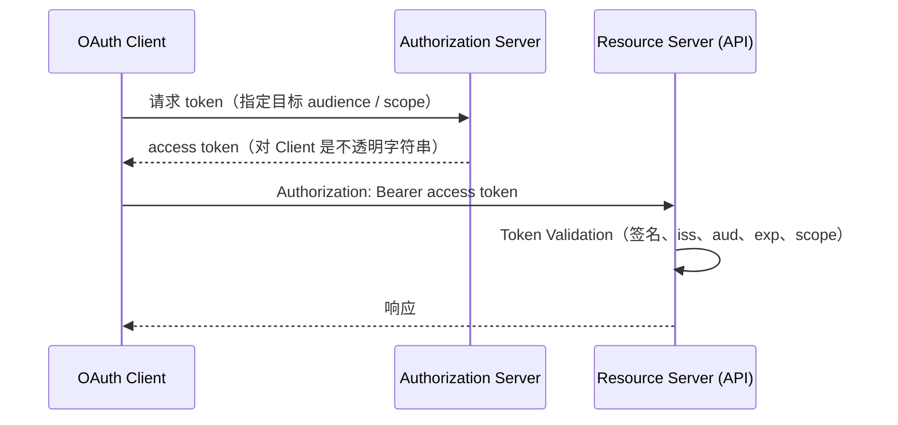

## Definition

Access token 是 [[OAuth Client]] 提交给 Resource Server 的访问凭据。它表示某个 issuer 对特定 audience、scope 和有效期授予的访问权。OAuth 2.0 本身没有规定 token 的格式；[[JSON Web Token]] 是常见格式，RFC 9068 定义了 JWT access token 的标准 profile。

## Key Terms

| 中文 | English | 含义 |
| --- | --- | --- |
| 访问令牌 | Access Token | 客户端用来访问受保护 API 的凭据 |
| 不透明令牌 | Opaque Token | 内容对客户端没有意义的字符串，需要向签发方查询 |
| 签发者 | Issuer（`iss`） | 签发 token 的一方 |
| 受众 | Audience（`aud`） | token 面向哪个 API |
| 范围 | Scope | 授予的访问范围 |
| 令牌内省 | Token Introspection | Resource Server 向授权服务器询问 token 当前是否有效及其元数据（RFC 7662） |
| 持有者令牌 | Bearer Token | 谁持有就能使用的 token |

## Typical Claims for a JWT Access Token

| Claim | Meaning |
| --- | --- |
| `iss` | 谁签发 token |
| `aud` | token 给哪个 API 使用 |
| `exp` / `nbf` | 有效时间范围 |
| `sub` / `oid` | subject identity |
| `scp` | delegated scopes（Microsoft Entra 的写法） |
| `roles` | application permissions/roles |
| `groups` | directory group object IDs |

### Standard vs Microsoft Entra

RFC 9068 的标准 JWT access token 要求包含 `iss`、`exp`、`aud`、`sub`、`iat`、`jti` 和 `client_id`，授权范围放在 `scope` claim 里。Microsoft Entra 的 access token 则用 `scp`（delegated 权限，空格分隔）、`roles`（应用权限，或用户被分配的 app role）、`azp`/`appid`（调用方应用）。不同 issuer 的 claim 名称不完全一致，写校验逻辑时应按实际 issuer 的文档为准。

## Where the Token Goes

## Lifetime

Microsoft identity platform 签发 access token 时，默认有效期是 60 到 90 分钟之间的随机值（平均 75 分钟），目的是把对 Entra 的请求分散开。有效期以 `exp` 为准，具体值取决于 issuer 的配置。

## Gotchas

- Access token 可能是 opaque token，不一定是 [[JSON Web Token]]；这时 Resource Server 需要用 introspection 等方式验证。
- Client 只应把 token 发给其 audience 对应的 API，并把它当作不透明字符串，不要自己解析。
- API 必须执行 [[Token Validation]]，不能只 base64 decode payload。
- Token 的 group/role 信息仍需映射成 [[Authorization]] policy。

## Connections

- Issued through [[OAuth 2.0]]
- Used by [[API Gateway]] and backend APIs

## Sources

- [RFC 9068 — JWT Profile for OAuth 2.0 Access Tokens](https://www.rfc-editor.org/rfc/rfc9068.html)
- [RFC 7662 — OAuth 2.0 Token Introspection](https://www.rfc-editor.org/rfc/rfc7662.html)
- [Microsoft identity platform access tokens](https://learn.microsoft.com/en-us/entra/identity-platform/access-tokens)
- [Microsoft Entra access token claims reference](https://learn.microsoft.com/en-us/entra/identity-platform/access-token-claims-reference)
