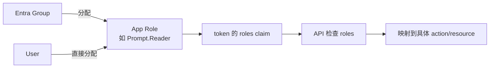

## Definition

App Roles 是在 Microsoft Entra application registration 中定义的应用专属角色。被分配角色的 user、group 或 application 可以在 token 的 `roles` claim 中获得相应值。

## Key Terms

| 中文 | English | 含义 |
| --- | --- | --- |
| 应用角色 | App Role | 在应用注册里定义的角色 |
| `roles` 声明 | `roles` Claim | token 里给用户或应用的角色值 |
| 角色分配 | App Role Assignment | 把角色分配给用户、组或应用 |
| 应用权限 | Application Permission | 分配给应用的 app role，用于无用户的调用 |
| 委托权限 | Delegated Permission / `scp` | 代表用户调用时授予的 scope |
| 允许的成员类型 | `allowedMemberTypes` | 角色能分配给用户、应用还是两者 |

## Why Use Them

| Raw directory groups | App roles |
| --- | --- |
| 属于 tenant 目录结构 | 属于 application contract |
| Token 常携带 group object ID | Token 携带业务角色值 |
| 组 object ID 只在其 tenant 内有意义 | Role definition 随 app registration |
| 容易暴露过多组织结构 | 只暴露应用需要的权限语义 |

常见模式是把 [[Microsoft Entra Group]] 分配给 App Role，然后 API 检查 `roles` claim。Microsoft 说明 groups 与 app roles 并不互斥，可以一起使用。

## Details

- 可以分配给 user、group、其他应用的 service principal，或 managed identity 的 service principal；`roles` claim 的值不能包含空格。
- 角色定义数量有上限：每个应用或服务主体默认 700 个权限定义，与对外暴露的 delegated scope 共用额度。
- Microsoft 建议用 app role 表达稳定的授权类别（如 Reader、Writer、Administrator），不要为每个资源、客户或操作单独定义角色；更细的资源级权限放在应用自己的授权数据里。
- 角色被禁用后，已有的分配仍会继续出现在 token 里，要从用户、组或应用上移除分配才会从 token 中消失。

## Gotchas

- Role 仍需在 backend 映射到具体 action/resource。
- Delegated `scp` 与 application/user `roles` 的语义不同。
- Group-to-role assignment 是否包含 nested membership，应按 tenant 配置和产品行为确认。
- 目前把 service principal 加入某个 group，再把 app role 分配给这个 group，Entra 不会在 token 里加入 `roles` claim。

## Connections

- [[Role-Based Access Control]]
- [[Authorization]]
- [[Group Claims]]

## Sources

- [Microsoft Entra app roles](https://learn.microsoft.com/en-us/entra/identity-platform/howto-add-app-roles-in-apps)
- [Microsoft Entra access token claims reference](https://learn.microsoft.com/en-us/entra/identity-platform/access-token-claims-reference)
