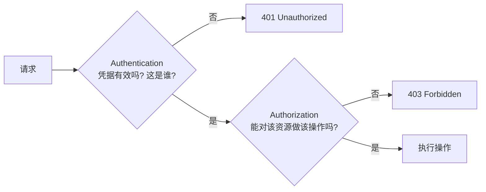

## Definition

Authentication（身份认证）回答：**当前 principal 是谁，以及系统为什么信任这个身份？** Principal 可以是 user、service、device 或 workload。

## Key Terms

| 中文 | English | 含义 |
| --- | --- | --- |
| 身份认证 | Authentication | 确认 principal 是谁，以及为什么可信 |
| 主体 | Principal | 发出请求的实体：用户、服务、设备或工作负载 |
| 凭据 | Credential | 用来证明身份的东西：密码、证书、令牌等 |
| 单点登录 | SSO（Single Sign-On） | 一次登录后访问多个应用 |
| 多因素认证 | MFA（Multi-Factor Authentication） | 同时使用多种凭据证明身份 |
| 依赖方 | Relying Party（RP） | 依赖 IdP 完成认证的应用 |

## Examples

- 员工通过 SSO + MFA 登录。
- Service 使用 certificate、client credential 或 signed request 表明身份。
- API 验证 access token 的 signature、issuer、audience 和 expiry。

## Authentication vs Authorization

通过 authentication 只说明身份可信，不说明该身份能够调用所有 API。之后仍需 [[Authorization]] 判断 action、resource 和 context。

在 HTTP 里，401 表示请求缺少有效的认证凭据，403 表示服务器理解请求但拒绝执行（RFC 9110）。

## Connections

- Login protocol: [[OpenID Connect]]
- Identity source: [[Identity Provider]]
- API evidence: [[Access Token]] and [[Token Validation]]

## Sources

- [OpenID Connect Core 1.0](https://openid.net/specs/openid-connect-core-1_0.html)
- [RFC 9110 — HTTP Semantics: 401 and 403](https://www.rfc-editor.org/rfc/rfc9110.html)
