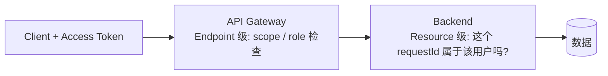

## Definition

Authorization（权限判断）回答：**某个 principal 是否可以对某个 resource 执行某个 action？**

```text
allow = policy(principal, action, resource, context)
```

## Key Terms

| 中文 | English | 含义 |
| --- | --- | --- |
| 授权 | Authorization | 判断主体能否对资源执行操作 |
| 策略 | Policy | 把主体、操作、资源和上下文映射成允许或拒绝的规则 |
| 范围 | Scope | OAuth 里对访问范围的声明，如 `responses.read` |
| 角色 | Role | 一组权限的命名集合，见 [[Role-Based Access Control]] |
| 资源级授权 | Resource-level Authorization | 针对具体对象（某个 requestId）的判断 |
| 基于属性的访问控制 | ABAC（Attribute-Based Access Control） | 用属性和规则判断访问，而不是只看角色 |

## Inputs

- Principal identity and tenant。
- OAuth `scope`、application `roles` 或 directory `groups`。
- Resource ownership、classification、environment。
- Context，例如 device posture、network 或 transaction risk。

## Layers

Gateway 可以做 endpoint-level scope 检查；backend 仍需做 resource-level authorization。例如 token 允许 `responses.read`，不表示用户能读取任何人的 `requestId`。



## Gotchas

- `projectId` 是 routing input，不是授权证明。
- UI 隐藏按钮不等于 server-side authorization。
- JWT 验证成功不等于 claims 满足业务 policy。

## Connections

- [[Authentication]]
- [[Role-Based Access Control]]
- [[Group Claims]]
- [[App Roles]]

## Sources

- [NIST — Role Based Access Control（含 RBAC 与 ABAC 的对比）](https://csrc.nist.gov/projects/role-based-access-control)
