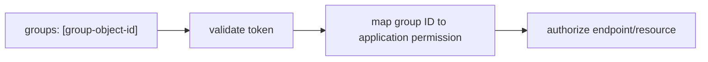
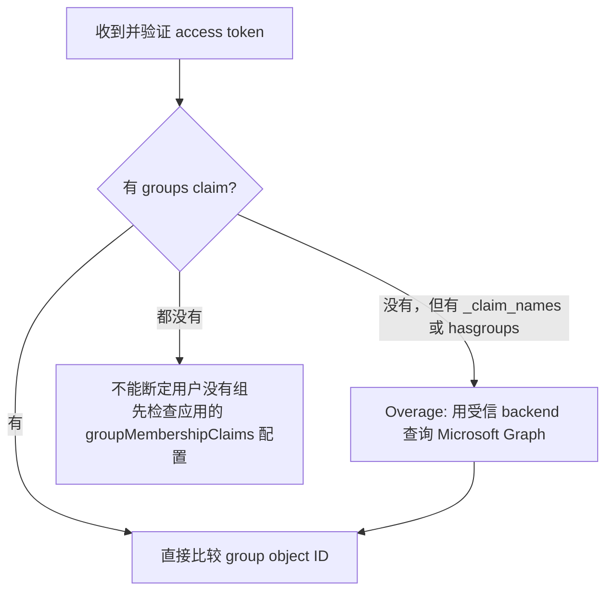

## Definition

Group claims 是 token 中表达 subject 目录组成员关系的 claims。在 Microsoft Entra token 中，`groups` 通常包含 [[Microsoft Entra Group]] 的 object IDs，而不是稳定的业务权限名称。

## Key Terms

| 中文 | English | 含义 |
| --- | --- | --- |
| 组声明 | Group Claims | token 里表达用户所属组的 claims |
| 组溢出 | Group Overage | 组太多，token 不再直接携带组列表 |
| 声明来源 | `_claim_names` / `groups:src1` | 溢出时指向完整列表来源的占位 claim |
| `hasgroups` | `hasgroups` | 为 true 表示用户至少属于一个组，应改用 Microsoft Graph 查询 |
| 对象 ID | Object ID | 组的不可变标识 |
| 传递成员 | Transitive Membership | 包含嵌套组的成员关系 |

## Authorization Flow



## Group Overage

Microsoft Entra 为了不让 HTTP header 过大，限制 token 里能包含的 group object ID 数量：JWT 最多 200 个，SAML 最多 150 个，这个数量包括嵌套组。超过限制时，Entra **不会发出 `groups` claim**，而是在 token 里加入 overage 标记，要求应用自己去 [[Microsoft Graph]] 查询完整的组。



溢出时 token 里的形式类似：

```json
"_claim_names": { "groups": "src1" }
```

官方提醒：token 里给出的 URL 可能是 Azure AD Graph（`graph.windows.net`）的地址，服务不要依赖它，应使用 `idtyp` optional claim 判断 token 是 app 还是 app+user，再自行构造 Microsoft Graph 的查询 URL。

## Gotchas

- 不能把 `groups` claim 缺失直接解释为“用户没有 group”。
- API 应比较 immutable object ID，而不是可重命名的 display name。
- Token 只反映签发时 membership；高风险操作可能需要更实时的检查。
- 若应用权限语义稳定，优先考虑把 groups 映射到 [[App Roles]]。

## Sources

- [Microsoft access-token claims reference](https://learn.microsoft.com/en-us/entra/identity-platform/access-token-claims-reference)
- [Microsoft Entra optional claims](https://learn.microsoft.com/en-us/entra/identity-platform/optional-claims)
- [Configure group claims and app roles](https://learn.microsoft.com/security/zero-trust/develop/configure-tokens-group-claims-app-roles)
