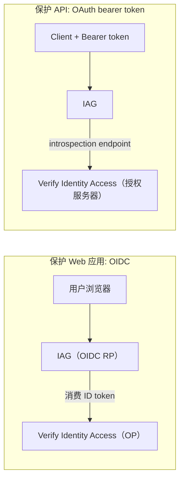

## Definition

IBM Security Access Manager（iSAM/ISAM）是旧称；官方文档现在把相关产品称为 IBM Verify Identity Access（曾用名 IBM Security Verify Access）。它提供 web access management、SSO、MFA、reverse proxy、federation，并可作为 OpenID Connect Provider 或验证 OAuth bearer token。

## Key Terms

| 中文 | English | 含义 |
| --- | --- | --- |
| IBM 应用网关 | IBM Application Gateway（IAG） | 保护 Web 应用或 API 的网关，可作为 OIDC RP |
| OpenID 提供方 | OpenID Connect Provider（OP） | 认证用户并签发 ID token |
| 依赖方 | Relying Party（RP） | 依赖 OP 的应用或网关 |
| 令牌内省 | OAuth Introspection | 向授权服务器查询 bearer token 是否有效 |
| 持有者令牌 | Bearer Token | 谁持有就能用的 token |
| 联合 | Federation | 信任上游 IdP 的认证结果 |

## Possible Roles

- 作为 [[Identity Provider]] / OIDC Provider。
- 作为 OAuth Authorization Server 签发 [[Access Token]]。
- 作为 relying party，信任 upstream IdP，例如 [[Microsoft Entra ID]]。
- 验证 bearer token、建立 session 或把 identity attributes 传给 downstream。

这些角色可以组合，但必须从实际 configuration 判断。

IBM 文档中的典型分工：OIDC 用来保护 Web 应用，OAuth token 用来保护 Web API。IBM Application Gateway 可以作为 OIDC relying party，消费 Verify Identity Access OP 提供的 identity token 建立会话；也可以接收请求头里的 OAuth bearer token，调用 introspection endpoint 验证 token，再用返回信息建立认证会话。

IBM 文档提醒，OIDC 的 Implicit flow 现在被视为安全最佳实践里的反模式，默认和推荐使用 Authorization Code flow。

## Relationship with Microsoft Entra ID

两者在 IdP、federation 和 token service 上有功能重叠，因此可能是替代方案；也可以通过 OIDC/SAML federation 形成 upstream/downstream。[[Microsoft Entra Group]] 只是目录授权数据，不会与 iSAM 产品本身“冲突”。

## How to Verify the Actual Role

- Client 的 authority/issuer URL 指向谁？
- Token `iss` 是 Entra 还是 iSAM？
- iSAM 是否重新签发 token 或只验证 upstream token？
- Groups/roles 是否由 iSAM 做 attribute mapping？

## Sources

- [IBM Verify Identity Access — Application Gateway: OIDC and OAuth introspection](https://docs.verify.ibm.com/gateway/docs/verify-access)
