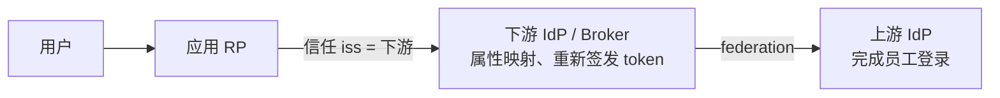

## Definition

Identity Provider（IdP）验证用户身份，并向依赖方提供可信 identity assertion。OIDC 中称为 OpenID Provider；SAML 中通常称 IdP。

## Key Terms

| 中文 | English | 含义 |
| --- | --- | --- |
| 身份提供方 | Identity Provider（IdP） | 验证用户并签发身份 assertion 的系统 |
| 授权服务器 | Authorization Server | 向 client 签发 access token 的服务 |
| 依赖方 | Relying Party（RP） | 依赖 IdP 完成认证的应用 |
| 联合 | Federation | 一个 IdP 信任另一个 IdP 的认证结果 |
| 上游 / 下游 IdP | Upstream / Downstream IdP | 被信任的一方 / 信任它的一方 |
| 属性映射 | Attribute Mapping | 把上游的用户属性转换成下游需要的 claims |
| 代理 / 中介 | Broker | 夹在应用和上游 IdP 之间做 federation 的服务 |

## Related but Different Role

OAuth Authorization Server 向 client 签发 access token。一个产品可以同时充当 IdP 和 Authorization Server，但两个角色概念上不同：前者服务登录身份，后者服务 API delegated access。

## Federation

一个 IdP 可以信任另一个 upstream IdP：上游完成员工登录，下游 broker 做 attribute mapping、session 或重新签发 token。此时必须用 token 的 `iss` 和 trust configuration 判断 app 最终信任谁。

## Implementations

- [[Microsoft Entra ID]]
- [[IBM Security Verify Access]]
- [[Amazon Cognito]] User Pool

## Sources

- [OpenID Connect Core 1.0](https://openid.net/specs/openid-connect-core-1_0.html)
- [IBM Verify Identity Access — OIDC provider and token validation](https://docs.verify.ibm.com/gateway/docs/verify-access)
- [Amazon Cognito — What is Amazon Cognito](https://docs.aws.amazon.com/cognito/latest/developerguide/what-is-amazon-cognito.html)
