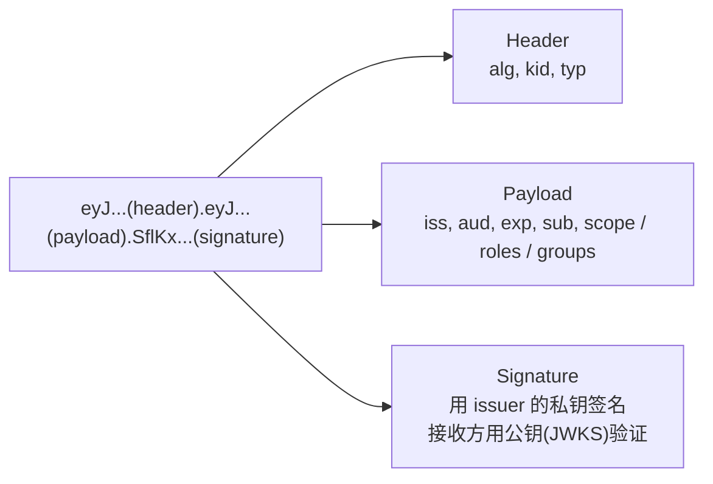

## Definition

JSON Web Token（JWT）是一种紧凑、URL 安全的 claims 表达格式，常见结构是 `header.payload.signature`。JWT 的 claims 可以作为 JWS（签名）结构的 payload，或者作为 JWE（加密）结构的明文。JWT 可以承载 access token、ID token 或其他 assertion，但 **JWT 不等于 OAuth**。

## Key Terms

| 中文 | English | 含义 |
| --- | --- | --- |
| 声明 | Claim | token 中关于主体或 token 本身的一条信息 |
| JSON 网络签名 | JWS（JSON Web Signature） | 带签名的结构，让接收方验证内容未被篡改 |
| JSON 网络加密 | JWE（JSON Web Encryption） | 加密的结构，内容对其他方不可见 |
| 密钥标识 | `kid`（Key ID） | 指明用哪把密钥签名 |
| 签名算法 | `alg` | 声明使用的签名算法 |
| 公钥集合 | JWKS（JSON Web Key Set） | issuer 发布的公钥集合，用来验证签名 |
| Base64URL | Base64URL | 编码方式，只是编码，不是加密或验证 |

## Structure

- Header：algorithm、key ID (`kid`) 等。
- Payload：`iss`、`aud`、`exp`、`sub`、scope、role、group 等 claims。
- Signature：让接收方验证内容由可信 issuer 签名且未被篡改。

## Gotchas

- Base64URL decode 不是验证。
- 必须限制允许的 algorithm，并从可信 metadata/JWKS 获取 key。RFC 8725 要求库使用明确的算法允许列表，并确保 header 里的 `alg` 与密钥匹配；攻击者可能把 `alg` 改成 `none`，一些库会信任它。RFC 9068 明确要求 Resource Server 必须拒绝 `alg` 为 `none` 的 JWT access token。
- Signature valid 仍不代表 audience、expiry 或权限正确。
- 不应把 secret、敏感个人信息或完整目录信息随意塞入 token；JWS 只保证不被篡改，不保证内容保密。

## Connections

- [[Access Token]]
- [[Token Validation]]
- [[Group Claims]]

## Sources

- [RFC 7519 — JSON Web Token (JWT)](https://www.rfc-editor.org/rfc/rfc7519.html)
- [RFC 8725 — JSON Web Token Best Current Practices](https://www.rfc-editor.org/rfc/rfc8725.html)
- [RFC 9068 — JWT Profile for OAuth 2.0 Access Tokens](https://www.rfc-editor.org/rfc/rfc9068.html)
