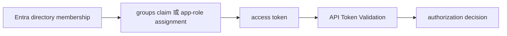

## Definition

Microsoft Entra Group 是 Entra directory 中的 group object，用于组织 users、devices 或 service principals，并可参与 application assignment 与授权。

## Key Terms

| 中文 | English | 含义 |
| --- | --- | --- |
| 安全组 | Security Group | 用于授权的组 |
| Microsoft 365 组 / 通讯组 | Microsoft 365 Group / Distribution List | 另一类组；`All` 选项会同时包含安全组和通讯组 |
| 对象 ID | Object ID | 组的不可变标识，API 应比较它而不是名称 |
| 嵌套成员 | Nested Membership | 组里包含其他组 |
| 组成员关系声明配置 | `groupMembershipClaims` | 应用清单里决定 token 携带哪类组的设置 |
| 分配给应用的组 | Groups Assigned to the Application（`ApplicationGroup`） | 只发出被分配给该应用的组 |
| 目录同步 | Directory Sync | 把本地 AD 对象同步到 Entra |

## Not a Validation Service

Group 本身不会签发或验证 token。典型链路是：

## Choosing What the Token Carries

应用清单里的 `groupMembershipClaims` 决定 token 里放哪类组：

| 值 | 内容 |
| --- | --- |
| `SecurityGroup` | 安全组 |
| `DirectoryRole` | 目录角色 |
| `All` | 安全组、目录角色和通讯组 |
| `ApplicationGroup` | 只包含分配给该应用的组 |

Microsoft 建议大型组织使用“分配给应用的组”，因为 token 里的组数量有上限（见 [[Group Claims]]）。Group optional claim 只会出现在用户主体的 JWT 里，不会出现在服务主体的 token 里。

## On-Prem AD vs Entra Group

On-premises Active Directory Security Group 与 Entra Group 是不同目录中的对象。它们可能通过同步或 hybrid identity 相关联，但不能默认 object ID、nested membership 和更新时效完全相同。通过 optional claims 可以让 token 携带本地 AD 的属性（例如 `sam_account_name`），但这要求组是从本地同步来的。

## Authorization Options

- API 直接检查 [[Group Claims]] 中的 group object ID。
- 把 group 分配给 [[App Roles]]，API 检查 `roles` claim。
- 需要完整或实时 membership 时查询 [[Microsoft Graph]]。

## Gotchas

- Group membership 不等于任意 endpoint permission，仍需明确 mapping。
- 大量 group membership 会产生 group overage。
- Token 中的 membership 是签发时快照，不是实时目录查询。

## Sources

- [Microsoft Entra optional claims: configure groups optional claims](https://learn.microsoft.com/en-us/entra/identity-platform/optional-claims)
- [Microsoft Entra access token claims reference](https://learn.microsoft.com/en-us/entra/identity-platform/access-token-claims-reference)
