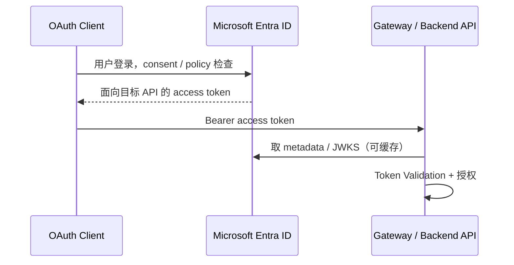

## Definition

Microsoft Entra ID（原 Azure Active Directory / Azure AD）是 Microsoft 的 cloud identity and access platform。它管理 users、applications、service principals、groups、authentication policies，并通过 Microsoft identity platform 提供 OAuth 2.0/OIDC endpoints 和 tokens。

## Key Terms

| 中文 | English | 含义 |
| --- | --- | --- |
| 租户 | Tenant | 一个组织在 Entra 里的目录实例 |
| 应用注册 | App Registration | 在 Entra 里登记 client 或 API，定义 redirect URI、scope、app roles |
| 服务主体 | Service Principal | 应用在某个租户里的身份 |
| 应用角色 | App Role | 应用自定义的角色，见 [[App Roles]] |
| 令牌版本 | Token Version（v1.0 / v2.0） | 决定 token 里有哪些 claims |
| 同意 | Consent | 用户或管理员授权应用访问其数据 |
| 目录对象 ID | Object ID（`oid`） | 用户或服务主体的不可变标识 |

## Role in an API Flow

1. 注册 [[OAuth Client]] 与目标 API。
2. 定义 redirect URI、scope、[[App Roles]] 和 token claims。
3. 用户完成登录与 consent/policy 检查。
4. Entra 向 client 签发面向目标 API 的 [[Access Token]]。
5. Gateway/backend 使用 Entra metadata/JWKS 完成 [[Token Validation]]。

## Token Versions

Entra 有 v1.0 和 v2.0 两种 access token，由 API 的应用注册里的 `requestedAccessTokenVersion` 设置决定：`null` 和 1 是 v1.0，2 是 v2.0。Entra 支持从任意版本的端点签发任意版本的 token，所以 token 版本由 API 决定，与 client 调用哪个端点无关。Token 默认有效期是 60 到 90 分钟之间的随机值。

## Directory Authorization

- [[Microsoft Entra Group]] 保存 membership。
- [[Group Claims]] 可把 group object IDs 放入 token。
- [[App Roles]] 提供更应用化的权限语义。
- [[Microsoft Graph]] 可查询目录与 group membership。

## Relationship with iSAM

Entra 与 [[IBM Security Verify Access]] 既可能是替代 issuer，也可能通过 federation 形成 upstream/downstream。必须检查最终 token issuer 与 trust configuration，不能从“使用 AD Group”推断。

## Sources

- [Microsoft identity platform access tokens](https://learn.microsoft.com/en-us/entra/identity-platform/access-tokens)
- [Microsoft Entra access token claims reference](https://learn.microsoft.com/en-us/entra/identity-platform/access-token-claims-reference)
