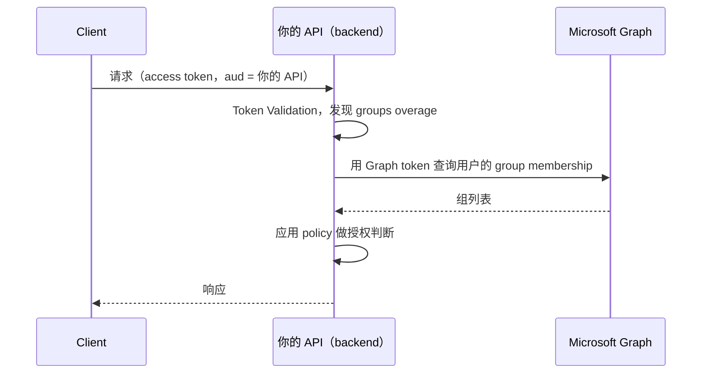

## Definition

Microsoft Graph 是访问 Microsoft 365 和 Microsoft Entra directory 数据的 API。与本知识图谱最相关的用途是查询 user、group 和 direct/transitive membership。

## Key Terms

| 中文 | English | 含义 |
| --- | --- | --- |
| 微软图 API | Microsoft Graph | 访问 Microsoft 365 和 Entra 目录数据的统一 API |
| 直接 / 传递成员 | Direct / Transitive Membership | 直接所属的组 / 包含嵌套组的所属关系 |
| Graph 权限 | Graph Permission | 调用 Graph 所需的权限，应遵循最小权限 |
| 组溢出 | Group Overage | 见 [[Group Claims]] |
| 受众 | Audience（`aud`） | Graph token 的 `aud` 是 Graph，不是你的 API |

## Role in Group Authorization

API 通常先验证面向自身的 [[Access Token]]。当 [[Group Claims]] 出现 overage，或业务需要更实时/完整的 membership 时，受信 backend 可以用单独、具有相应 Graph permission 的 token 查询 Microsoft Graph。例如“列出用户的直接和传递成员关系”接口可以返回用户所属的组、目录角色和管理单元。

## What It Is Not

- 它不是 [[Microsoft Entra ID]] 的 token issuer。
- 它不是通用 JWT validation service。
- 面向 Microsoft Graph 的 token 不能当成自定义 API 的 token，因为 `aud` 不同；反过来，你的 API 也不能按自己的规则验证 Graph token。

## Gotchas

- Graph permissions 可能非常敏感，应遵循 least privilege。
- 不应由不受信 frontend 直接决定要查询哪个用户的 membership。
- Directory read 与 API authorization 是两步；查询到 membership 后仍需应用 policy。

## Connections

- [[Microsoft Entra Group]]
- [[Group Claims]]
- [[Token Validation]]

## Sources

- [Microsoft Graph — List a user's memberships (direct and transitive)](https://learn.microsoft.com/en-us/graph/api/user-list-transitivememberof)
- [Microsoft Entra access token claims reference: groups overage](https://learn.microsoft.com/en-us/entra/identity-platform/access-token-claims-reference)
