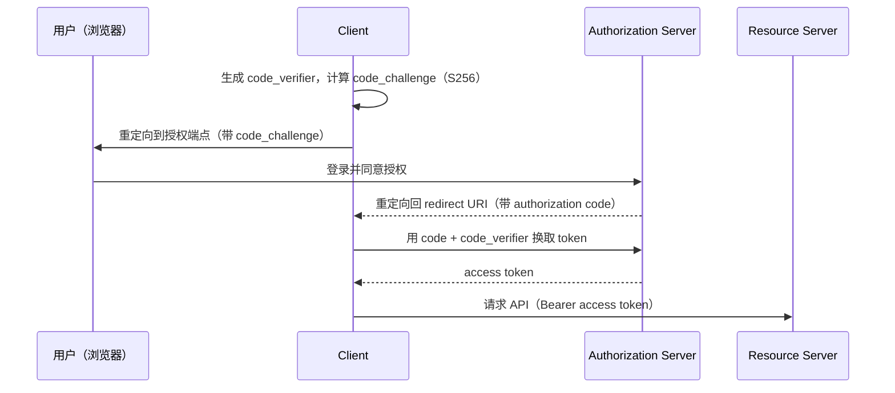

## Definition

OAuth 2.0 是授权框架，让 [[OAuth Client]] 在得到授权后使用 [[Access Token]] 访问 Resource Server。OAuth 本身主要解决 delegated API access，而不是定义用户登录身份。它的出发点是避免用户把自己的密码交给第三方应用：客户端拿到的是由授权服务器签发、范围受限的 token，而不是用户的凭据。

## Key Terms

| 中文 | English | 含义 |
| --- | --- | --- |
| 资源所有者 | Resource Owner | 能够授予访问权的一方，通常是用户 |
| 客户端 | Client | 请求 access token 的应用 |
| 授权服务器 | Authorization Server | 认证相关主体并签发 token |
| 资源服务器 | Resource Server | 接收 token 并保护 API |
| 授权码 | Authorization Code | 授权后经浏览器重定向返回、用来换取 token 的一次性凭证 |
| 授权类型 | Grant Type | 获取 token 的流程，如 Authorization Code、Client Credentials |
| 重定向 URI | Redirect URI | 授权完成后服务器把用户送回的地址 |
| 授权码交换证明密钥 | PKCE（Proof Key for Code Exchange） | 防止授权码被截获后被他人兑换 |

## Authorization Code with PKCE

## Which Grants to Use

- **Authorization Code + PKCE**：面向用户的应用。RFC 9700 要求公共客户端必须使用 PKCE，也建议机密客户端使用；授权服务器必须支持 PKCE。
- **Client Credentials**：机器对机器，没有用户参与。
- **Implicit grant**：RFC 9700 建议客户端不要使用（直接在授权响应里返回 access token）。
- **Resource Owner Password Credentials grant**：RFC 9700 规定不得使用，因为它把用户凭据暴露给客户端，也无法配合多因素认证。

授权服务器比较 redirect URI 时，必须做精确字符串匹配（原生应用的 localhost 端口除外）。

## Browser Applications

Browser SPA 通常使用 Authorization Code + PKCE，并且不能安全保存 client secret。BFF 则可以在 server side 保存机密信息并为 browser 管理 session。

## Gotchas

- Access token 不保证一定是 [[JSON Web Token]]。
- Token 必须面向目标 API 的 audience；Microsoft Graph token 不能直接用来调用自定义 API。
- OAuth 对资源服务器自己的 API 路径结构没有要求；变化的是 token 和 redirect URI（redirect URI 反而要预先注册并严格匹配），见 [[Static and Parameterized API Paths]]。
- 登录身份语义由 [[OpenID Connect]] 补充。

## Connections

- [[OAuth Client]]
- [[Access Token]]
- [[Token Validation]]

## Sources

- [RFC 6749 — The OAuth 2.0 Authorization Framework](https://www.rfc-editor.org/rfc/rfc6749.html)
- [RFC 7636 — Proof Key for Code Exchange (PKCE)](https://www.rfc-editor.org/rfc/rfc7636.html)
- [RFC 9700 — Best Current Practice for OAuth 2.0 Security](https://www.rfc-editor.org/rfc/rfc9700.html)
