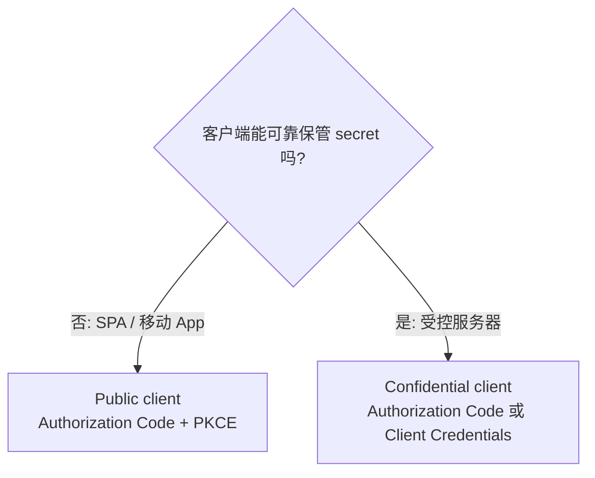

## Definition

OAuth Client 是代表用户或自身向 Authorization Server 请求 token、再访问 Resource Server 的应用。它可以是 frontend SPA、mobile app、server-side web app、BFF 或 machine-to-machine service。

## Key Terms

| 中文 | English | 含义 |
| --- | --- | --- |
| 公共客户端 | Public Client | 无法可靠保管凭据的客户端（SPA、移动 App） |
| 机密客户端 | Confidential Client | 能保管凭据或能用其他方式安全认证的客户端（受控服务器） |
| 客户端标识 | `client_id` | 注册时分配的客户端标识 |
| 客户端密钥 | Client Secret | 机密客户端用来向授权服务器证明身份的凭据 |
| 重定向 URI | Redirect URI | 授权完成后回调的地址，需预先注册 |
| 后端代理前端 | BFF（Backend for Frontend） | 在服务端保存机密并为浏览器管理 session 的后端 |

## Client Types

| Type | Secret handling | Typical flow |
| --- | --- | --- |
| Public client | 无法可靠保管 secret | Authorization Code + PKCE |
| Confidential client | 可在受控 server 保管 secret/key | Authorization Code、Client Credentials |

RFC 6749 的定义：机密客户端能够保持其凭据的机密性，或能用其他方式安全地认证自己；公共客户端则做不到这一点。

## Registration Inputs

- `client_id`
- redirect URI（授权服务器应做精确匹配）
- allowed grant/response types
- allowed scopes and target audience
- logout/callback settings
- confidential client 才可能使用 secret 或 certificate

## Gotchas

- Client 不应自己伪造 JWT。
- Frontend 不应内置 client secret。
- Client 应把 access token 视为不透明字符串，不要自己解析或验证；验证是目标 API 的职责。
- “OAuth CLI”如果不是 command-line tool，通常实际指 OAuth Client。

## Connections

- Protocol: [[OAuth 2.0]]
- Receives: [[Access Token]]
- Registered with: [[Microsoft Entra ID]], [[IBM Security Verify Access]], or [[Amazon Cognito]]

## Sources

- [RFC 6749 — Client Types](https://www.rfc-editor.org/rfc/rfc6749.html)
- [RFC 9700 — OAuth 2.0 Security Best Current Practice](https://www.rfc-editor.org/rfc/rfc9700.html)
- [Microsoft identity platform access tokens](https://learn.microsoft.com/en-us/entra/identity-platform/access-tokens)
