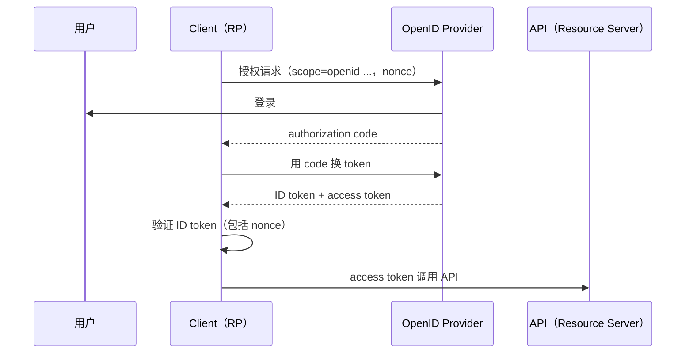

## Definition

OpenID Connect（OIDC）是在 [[OAuth 2.0]] 之上增加身份认证语义的协议。它让 client 通过 OpenID Provider 返回的 ID token 确认登录用户身份。

## Key Terms

| 中文 | English | 含义 |
| --- | --- | --- |
| OpenID 提供方 | OpenID Provider（OP） | 认证用户并签发 ID token 的服务 |
| 依赖方 | Relying Party（RP） | 依赖 OP 完成认证的 client |
| ID 令牌 | ID Token | 给 client 的登录身份 assertion |
| 发现文档 | Discovery Document | OP 发布的 metadata，位于 `/.well-known/openid-configuration` |
| 用户信息端点 | UserInfo Endpoint | 在授权条件满足时返回用户 claims |
| 随机数 | `nonce` | 绑定请求与 ID token，防止重放 |
| `openid` 范围 | `openid` scope | 请求 OIDC 认证所必须的 scope |

## Authorization Code Flow with ID Token

## Important Artifacts

- ID token：给 client 的登录身份 assertion。
- Access token：给 API/Resource Server 的调用凭据。
- Discovery document：发布 issuer、authorization endpoint、token endpoint、JWKS URI 等 metadata。
- UserInfo endpoint：在授权条件满足时返回用户 claims。

## Gotchas

- ID token 的 audience 是 client；不要把它当成任意 API 的通用 access token。
- 请求里有 `nonce` 时，ID token 必须包含 `nonce` claim，并且值与请求中的一致；RFC 9700 还要求 PKCE challenge 或 nonce 不能使用固定值。
- OIDC federation 可以让一个身份平台成为另一个平台的 upstream IdP。
- 实际信任边界由 issuer 和签名验证确定，而不是由登录页面 logo 确定。

## Connections

- [[Identity Provider]]
- [[Access Token]]
- [[Token Validation]]
- [[OAuth 2.0]]

## Sources

- [OpenID Connect Core 1.0](https://openid.net/specs/openid-connect-core-1_0.html)
- [OpenID Connect Discovery 1.0](https://openid.net/specs/openid-connect-discovery-1_0.html)
- [RFC 9700 — OAuth 2.0 Security Best Current Practice](https://www.rfc-editor.org/rfc/rfc9700.html)
