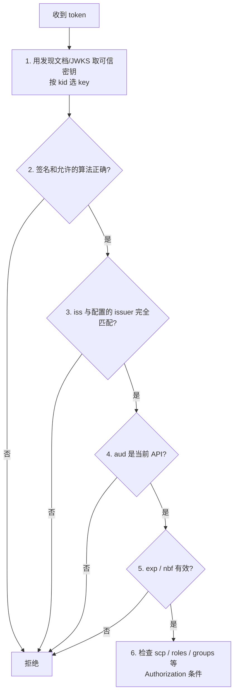

## Definition

Token validation 是 Resource Server、gateway 或 authorizer 在信任 token 前完成的密码学与语义检查。

## Key Terms

| 中文 | English | 含义 |
| --- | --- | --- |
| 令牌验证 | Token Validation | 信任 token 前的签名和语义检查 |
| 发现文档 | Discovery Document | issuer 发布的 metadata，含 JWKS URI 等 |
| 密钥轮换 | Key Rollover | issuer 定期更换签名密钥 |
| 受众 | Audience（`aud`） | token 面向的 API |
| 租户 | Tenant（`tid`） | Microsoft Entra 的目录实例 |
| 混淆代理 | Confused Deputy | 接受了发给别的 API 的 token，被误用来代为越权 |
| 内省 | Introspection | 向 issuer 询问不透明 token 是否有效 |

## Minimum Checks for JWT

1. 从配置的 OIDC discovery/JWKS 获取可信 signing keys。
2. 根据 `kid` 选择 key 并验证 signature 与允许的 algorithm。
3. 验证 `iss` 与配置的 issuer 完全匹配。
4. 验证 `aud` 是当前 API。
5. 验证 `exp`、`nbf`，必要时验证 tenant/client/token type。
6. 最后检查 `scp`、`roles`、`groups` 等 [[Authorization]] 条件。

RFC 9068 对 JWT access token 还要求：检查 header `typ` 是 `at+jwt`，`aud` 包含自己的资源标识，用授权服务器提供的密钥验证签名，并拒绝 `alg` 为 `none`。注意 Microsoft 文档里的 Entra 示例 token，header 的 `typ` 是 `JWT`，所以这条检查要按实际 issuer 的行为决定，不能原样套用。

## Microsoft Entra Specifics

- Web API 必须验证发给它的 access token，并且只接受 `aud` 是自己的 token；Client 不应尝试验证 access token。
- **版本**：token 的 `ver` 为 1.0 时，从 v1.0 的 metadata 端点读取发现文档；`ver` 为 2.0 时，从 v2.0 端点读取，与 API 配置的 authority 版本无关。v2.0 token 的 `aud` 总是 API 的 client ID，v1.0 的 `aud` 可能是 client ID 或资源 URI。
- **Issuer**：使用租户专属的 metadata 端点时，`iss` 必须与 metadata 里的 issuer 完全匹配。使用租户无关的 `common` 端点时，要先把 issuer 里的 `{tenantid}` 换成当前请求对应的租户 ID，再做完全匹配。
- 以 `tid` 作为信任边界的应用，要确认 `tid` 是 GUID，并且 issuer 与 `tid` 一致。
- 为 Microsoft Graph 签发的 token 不能按这些规则验证，也不能拿来调用自己的 API。

## Where It Can Run

- [[IBM API Connect]] policy。
- [[AWS API Gateway]] JWT/Cognito/Lambda authorizer。
- Backend framework middleware。
- 对 opaque token 使用 issuer 的 introspection endpoint（RFC 7662）。

## Gotchas

- 不要接受为另一个 API 签发的 token，否则可能形成 confused deputy。
- Signing keys 会 rollover，应通过 metadata/JWKS 更新，而不是硬编码单一 key；有缓存的实现（如 API Gateway 最长缓存公钥两小时）在轮换时需要留一段新旧密钥同时有效的宽限期。
- 验证 token 与查询 [[Microsoft Graph]] 是不同工作。

## Connections

- [[JSON Web Token]]
- [[Access Token]]
- [[Authorization]]

## Sources

- [Microsoft identity platform access tokens: validate tokens](https://learn.microsoft.com/en-us/entra/identity-platform/access-tokens)
- [Microsoft Entra access token claims reference](https://learn.microsoft.com/en-us/entra/identity-platform/access-token-claims-reference)
- [RFC 9068 — JWT Profile for OAuth 2.0 Access Tokens: validation](https://www.rfc-editor.org/rfc/rfc9068.html)
- [RFC 7662 — OAuth 2.0 Token Introspection](https://www.rfc-editor.org/rfc/rfc7662.html)
- [API Gateway JWT authorizer](https://docs.aws.amazon.com/apigateway/latest/developerguide/http-api-jwt-authorizer.html)
