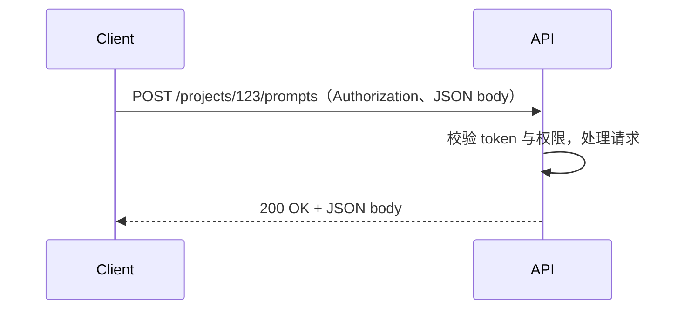

## Definition

API endpoint 是客户端能够调用的 API 操作入口。严格讨论时，应同时说明 HTTP method 与 path，例如 `POST /projects/{projectId}/prompts`；只有 URL 往往不足以唯一描述操作。

## Key Terms

| 中文 | English | 含义 |
| --- | --- | --- |
| 端点 | Endpoint | 客户端可调用的 API 操作入口 |
| 方法 | HTTP Method | 对资源执行的操作，如 GET、POST |
| 路径 | Path | 资源位置，可以包含路径参数 |
| 路径参数 | Path Parameter | 路径里可变的部分，如 `{projectId}` |
| 查询参数 | Query Parameter | URL `?` 之后的键值对 |
| 请求体 | Request Body | 随请求发送的数据 |
| 状态码 | Status Code | 响应结果的数字标识，如 200、202、404 |
| 操作 | Operation | 一个“路径 + 方法”的组合 |

## Composition

```text
https://api.example.com/v1/projects/123/prompts
└ scheme └── host ──┘└base┘└── resource path ──┘
```

- `method`: `GET`、`POST`、`PUT`、`PATCH`、`DELETE`。
- `path`: 资源位置，可以包含 path parameter。
- `request`: headers、query、path parameters 和 body。
- `response`: status code、headers 和 body。
- `security`: 调用需要的 token、scope 或 role。



## Gotchas

- `GET` 表示读取，不表示“服务器返回”；每个 HTTP request 都有 response。
- 同一 path 的 `GET` 与 `POST` 是两个不同 operation。
- endpoint 名字不能代替 request/response contract。

## Connections

- Designed in [[Endpoint Design]]
- Described by [[OpenAPI Specification]]
- Routed by [[API Gateway]]

## Sources

- [RFC 9110 — HTTP Semantics](https://www.rfc-editor.org/rfc/rfc9110.html)
- [OpenAPI Specification: Path Item and Operation](https://spec.openapis.org/oas/latest.html)
