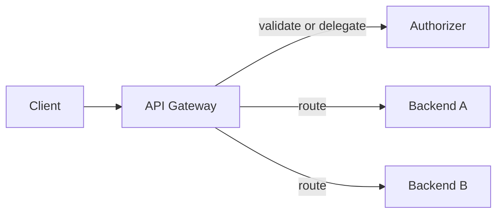
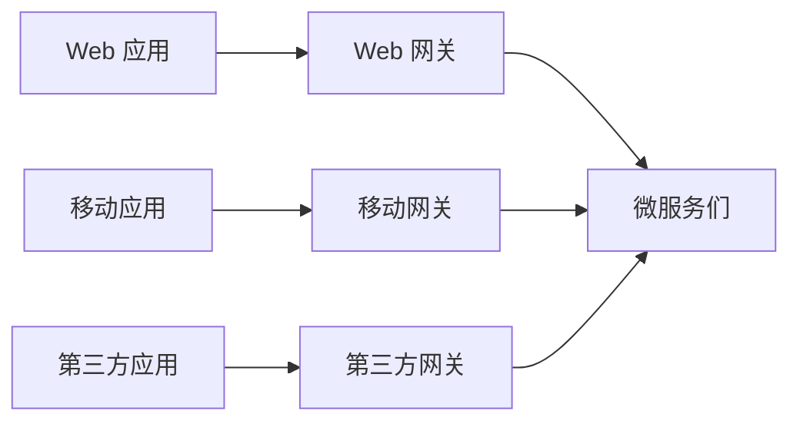

## Definition

API Gateway 是位于 client 与 backend service 之间的 API traffic entry point。它通常处理 routing、protocol termination、authentication integration、coarse-grained authorization、rate limiting、logging 和 backend integration。

## Key Terms

| 中文 | English | 含义 |
| --- | --- | --- |
| API 网关 | API Gateway | 所有客户端请求的统一入口 |
| 数据面 | Data Plane（Runtime） | 实际接收并转发请求的部分 |
| 授权器 | Authorizer | 验证或委托验证 token 的组件 |
| 请求路由 | Request Routing | 把请求转发到对应服务 |
| API 组合 | API Composition | 一个请求扇出到多个服务再合并结果 |
| 协议转换 | Protocol Translation | 把对外的 Web 友好协议转成内部协议 |
| 限流 | Rate Limiting | 限制调用速率 |
| 后端的前端 | BFF（Backends for Frontends） | 为每类客户端各设一个网关 |

## Responsibilities

microservices.io 把它描述成所有客户端的单一入口：有些请求被直接代理或路由到对应服务，有些请求则扇出到多个服务再合并。它还可以为每类客户端提供不同的 API，并实现安全检查，例如验证客户端是否有权执行该请求。好处包括让客户端不必关心应用如何拆分成微服务、减少往返次数、把调用多个服务的逻辑从客户端移到网关；代价是多了一个需要开发、部署和运维的组件，以及额外的一跳网络延迟。

Gateway 可以验证 token，但通常不负责员工账号生命周期，也不天然是 [[Identity Provider]]。它执行的安全策略来自配置、authorizer 或外部 identity system。

## Backends for Frontends

## Gateway vs API Management

- Gateway 是 request data plane 的入口与执行点。
- [[API Management]] 还包括 design、catalog、developer onboarding、subscription、analytics 和 lifecycle governance。

## Gotchas

- Authentication 成功不等于所有 endpoint 都被授权。
- API key 不应替代用户身份与业务权限。
- 两层 gateway 可以共存，但必须写清楚每层验证和转发什么。

## Implementations

- [[IBM API Connect]]
- [[AWS API Gateway]]

## Sources

- [microservices.io — API Gateway pattern](https://microservices.io/patterns/apigateway.html)
- [Azure API Management — key concepts: API gateway](https://learn.microsoft.com/en-us/azure/api-management/api-management-key-concepts)
