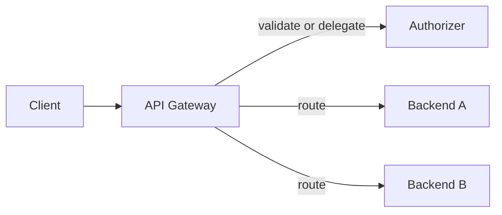

## Definition

API Gateway 是位于 client 与 backend service 之间的 API traffic entry point。它通常处理 routing、protocol termination、authentication integration、coarse-grained authorization、rate limiting、logging 和 backend integration。

## Responsibilities

Gateway 可以验证 token，但通常不负责员工账号生命周期，也不天然是 [[Identity Provider]]。它执行的安全策略来自配置、authorizer 或外部 identity system。

## Gateway vs API Management

- Gateway 是 request data plane 的入口与执行点。
- [[API Management]] 还包括 design、catalog、developer onboarding、subscription、analytics 和 lifecycle governance。

## Gotchas

- Authentication 成功不等于所有 endpoint 都被授权。
- API key 不应替代用户身份与业务权限。
- 两层 gateway 可以共存，但必须写清楚每层验证和转发什么。

## Implementations

- [[IBM API Connect]]
- [[AWS API Gateway]]

