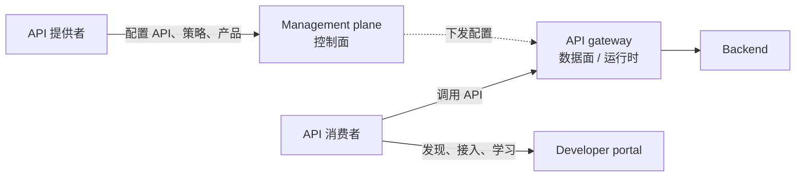

## Definition

API Management 是管理 API 完整生命周期的能力集合：design、publish、secure、onboard consumers、rate limit、observe、version 和 retire。

## Key Terms

| 中文 | English | 含义 |
| --- | --- | --- |
| API 管理 | API Management | 管理 API 完整生命周期的能力集合 |
| 控制面 / 管理面 | Control Plane / Management Plane | 配置 API、策略和消费者的部分 |
| 数据面 / 运行时 | Data Plane / Runtime | 接收请求并执行策略的 API gateway |
| 开发者门户 | Developer Portal | 供 API 消费者发现、接入和学习 API 的网站 |
| 产品 | Product | 把 API 打包给消费者订阅的单位 |
| 策略 | Policy | 配额、转换、验证等对 API 的规则 |
| 自托管网关 | Self-hosted Gateway | 部署在 API 所在环境里的网关 |

## Control Plane and Data Plane

| Plane | 典型职责 |
| --- | --- |
| Control plane | API catalog、product/plan、consumer app registration、policy configuration |
| Data plane | 接收 request、执行 policy、验证 credential、限流、转发 |

[[API Gateway]] 往往是 data plane 的核心，但 API Management 的范围更广。

以 Azure API Management 为例，它由三部分组成：API gateway（也叫 data plane 或 runtime，所有客户端请求先到这里，再转发到后端，让 API 提供者可以抽象后端实现）、management plane（也叫 control plane，API 提供者在这里打包 API 成 product、设置配额或转换等 policy）、developer portal（API 消费者发现和接入 API 的网站）。它还提供 self-hosted gateway，可以部署到 API 所在的环境。不同产品的名词不同，但这个划分是通用的。

## Enterprise Use

企业可能在 AWS 前放一层统一 API Management，以获得跨平台的 consumer identity、审计、quota 和 governance；AWS 内部再由 [[AWS API Gateway]] 对接 Lambda 或其他服务。

## Connections

- Implemented by [[IBM API Connect]]
- Described with [[OpenAPI Specification]]
- Enforces policies related to [[Authentication]] and [[Authorization]]

## Sources

- [Azure API Management — key concepts](https://learn.microsoft.com/en-us/azure/api-management/api-management-key-concepts)
