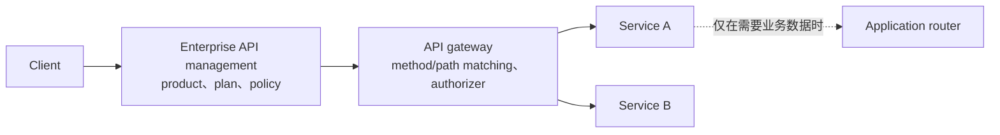

## Definition

API routing 根据 host、HTTP method、path、headers 或其他明确规则，把 request 送往对应 backend integration。

## Key Terms

| 中文 | English | 含义 |
| --- | --- | --- |
| 路由 | Routing | 按规则把请求送到对应后端 |
| 集成 | Integration | 路由到达的后端目标 |
| 数据面 | Data Plane | 实际处理请求的运行时 |
| 网关 | Gateway | API 流量的统一入口 |
| 应用内路由 | Application Router | 业务代码里的分发 |
| 额外一跳 | Extra Hop | 请求多经过一次网络转发 |

## Routing Layers

| Layer | 适合的职责 |
| --- | --- |
| Enterprise API management | API product、consumer plan、policy、跨平台转发 |
| API gateway | method/path matching、authorizer、integration selection |
| Application router | 业务级 dispatch、feature flag、租户内部选择 |
| Business service | 业务规则，而不是通用入口治理 |

## Design Principle

优先让能够理解稳定 API contract 的最前层完成粗粒度 routing；业务服务只保留必须依赖业务数据的选择。把所有项目流量先送到一个业务 Lambda 再转发，会把 routing、业务逻辑和权限边界耦合在一起，并多出一次网络转发。API gateway 的好处之一是让客户端不必知道后端怎样划分成服务。

## Gotchas

- Gateway routing 不会自动完成 resource-level [[Authorization]]。
- 改成不同 path 后，仍需检查 integration 是否真的指向不同 backend。
- 不能因为 gateway 返回 `200` 就认为 downstream 行为正确。

## Connections

- [[API Gateway]]
- [[IBM API Connect]]
- [[AWS API Gateway]]
- [[Gateway-First Multi-Project Routing Case Study]]

## Sources

- [microservices.io — API Gateway pattern](https://microservices.io/patterns/apigateway.html)
- [Azure API Management — key concepts](https://learn.microsoft.com/en-us/azure/api-management/api-management-key-concepts)
