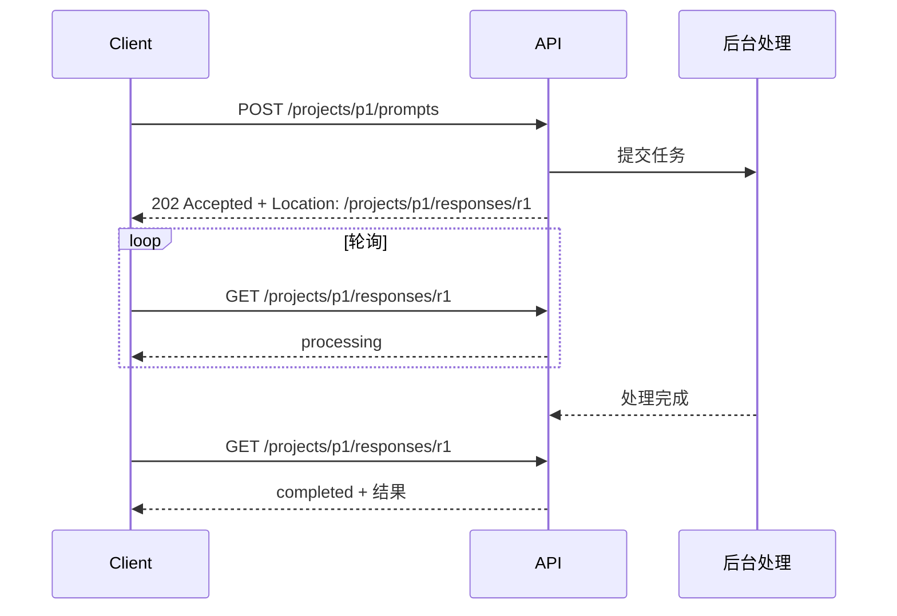

## Definition

Endpoint design 是把业务能力映射成稳定、可理解、可授权的 [[API Endpoint]]。设计不只是取 URL 名字，还包括资源边界、HTTP method、状态码、幂等性、错误模型和权限要求。

## Key Terms

| 中文 | English | 含义 |
| --- | --- | --- |
| 端点设计 | Endpoint Design | 把业务能力映射成稳定、可授权的端点 |
| 资源 | Resource | API 操作的对象，如 prompt、job |
| 契约 | Contract | request/response 的格式和语义约定 |
| 202 已接受 | `202 Accepted` | 请求已接受处理，但尚未完成 |
| 状态端点 | Status Endpoint | 让客户端查询异步请求进度的端点 |
| 轮询 | Polling | 客户端定期查询状态 |
| 幂等性 | Idempotency | 重复请求的效果与一次相同，见 [[Idempotency]] |

## Design Checklist

| 维度 | 问题 |
| --- | --- |
| Resource | 客户端操作的是 prompt、conversation 还是 job？ |
| Method | 是创建、读取、替换、部分更新还是删除？ |
| Contract | request/response schema 是否明确？ |
| Identity | 谁在调用？token 面向哪个 API？ |
| Authorization | 需要什么 scope、role 或资源归属？ |
| Lifecycle | 是同步响应还是 `202 Accepted` 后轮询？ |
| Operations | 如何限流、审计、追踪与版本化？ |

## Example

同步模式：

```text
POST /projects/{projectId}/prompts
→ 200 OK + answer
```

异步模式：

```text
POST /projects/{projectId}/prompts
→ 202 Accepted + requestId

GET /projects/{projectId}/responses/{requestId}
→ processing | completed | failed
```

## Asynchronous Request-Reply

当 POST、PUT、PATCH 或 DELETE 需要较长时间处理时，等待完成再响应会造成不可接受的延迟。Microsoft 的 API 设计指南建议：这类方法应返回 `202 Accepted`，表示请求已被接受处理但尚未完成，并提供一个状态端点，URI 放在响应的 `Location` 头里，让客户端轮询。如果异步操作最终创建了新资源，状态端点在完成后应返回 `303 See Other`，并在 `Location` 头里给出新资源的 URI。



后台处理在 AWS 上怎样实现，见 [[Lambda Async Processing Options]]。

## Connections

- Paths: [[Static and Parameterized API Paths]]
- Contract: [[OpenAPI Specification]]
- Traffic: [[API Routing]]
- Security: [[Authentication]] and [[Authorization]]

## Sources

- [Microsoft — Web API design best practices: asynchronous methods](https://learn.microsoft.com/en-us/azure/architecture/best-practices/api-design)
- [RFC 9110 — 202 Accepted](https://www.rfc-editor.org/rfc/rfc9110.html#name-202-accepted)
