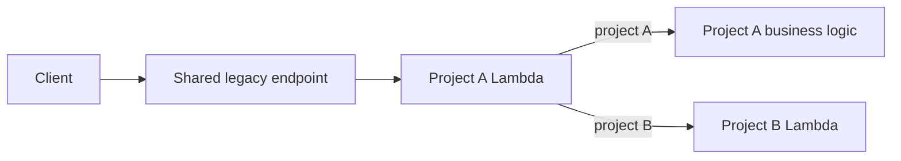
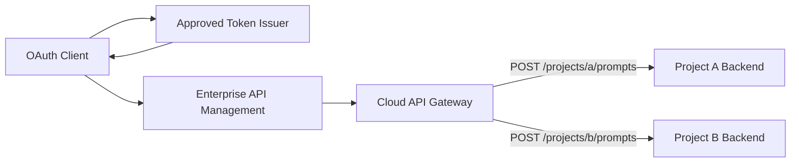

> [!warning] De-identified and unverified
> 这是由工作讨论抽象出的案例，不包含真实公司、项目或 URL。实际 issuer、gateway 配置和内部标准仍需设计图与平台配置确认。

## Symptom

多个项目共享一个 legacy endpoint。客户端在 request body 中携带 `projectId`，流量先进入 Project A 的 Lambda；当 `projectId` 指向 Project B 时，再由 A 转发到 B。

结果是 Project A 同时承担业务处理、routing、identity propagation 和额外 network hop。

## Candidate Target

也可以使用 `/projects/{projectId}/prompts`，但 gateway 必须能够把该参数映射到受控 integration；不能允许任意 backend 地址由客户端决定。

## Identity Architecture Candidates

### 1. Microsoft Entra ID is the issuer

Client 直接从 [[Microsoft Entra ID]] 获得 access token；APIC、AWS authorizer 或 backend 使用 Entra OIDC metadata/JWKS 做 [[Token Validation]]。

### 2. iSAM is a broker or downstream issuer

[[IBM Security Verify Access]] 把 Entra 作为 upstream IdP，完成 federation/attribute mapping，再向 client 或 API 签发 iSAM token。此时 app 看到的 `iss` 通常是 iSAM。

### 3. iSAM validates or protects an Entra-issued token

Client 获得 Entra token；iSAM/APIC 在入口验证或执行 policy，然后把可信 identity context 传给下游。此时必须确认原 token 是否被保留、exchange 或替换。

这些是候选模式，不应凭 “使用 AD Group” 推断实际采用哪一种。

## Authorization

- [[Microsoft Entra Group]] 可以成为目录中的成员关系来源。
- [[Group Claims]] 或 [[App Roles]] 可以把授权信号带入 access token。
- API 仍需把 claim 映射成 endpoint/resource permission。
- group overage 或需要实时 membership 时，可能查询 [[Microsoft Graph]]。

## Static vs Dynamic

固定 domain、多个固定 path、参数化 path 与 OAuth 可以同时存在。参见 [[Static and Parameterized API Paths]]。

## Verification Checklist

- Frontend 的 `authority`、authorization endpoint 和 token endpoint 指向谁？
- Access token 的 `iss`、`aud`、`scp`、`roles`、`groups` 是什么？
- Gateway/authorizer 配置的 issuer、audience 与 JWKS URI 是什么？
- iSAM 是否重新签发 token，还是验证/代理 Entra token？
- Group 是直接 membership、nested membership，还是映射为 app role？
- APIC 与 AWS gateway 各自负责哪些 validation、authorization、routing 和 audit？

## Takeaway

不要从产品名称推断链路。用 **issuer、audience、claims、trust configuration 和 integration target** 证明“谁签发、谁验证、谁授权、谁路由”。

## Related Concepts

- [[Endpoint Design]]
- [[API Routing]]
- [[Authentication]]
- [[Authorization]]
- [[OAuth 2.0]]
- [[IBM API Connect]]

