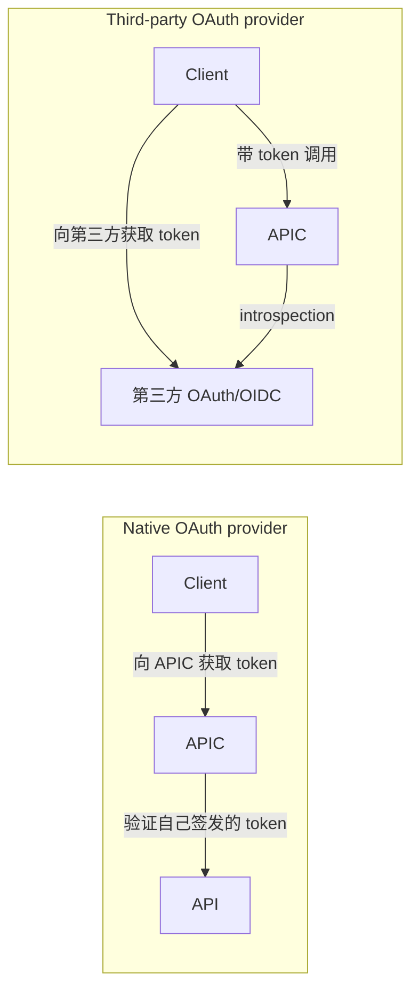

## Definition

IBM API Connect（APIC）是 API Management 平台，可用于设计、发布、保护、治理、分析和转发 API。它包含 gateway 能力（基于 IBM DataPower Gateway），因此与 [[AWS API Gateway]] 同时出现并不矛盾。

## Key Terms

| 中文 | English | 含义 |
| --- | --- | --- |
| API Connect | IBM API Connect（APIC） | IBM 的 API 管理平台 |
| 原生 OAuth 提供方 | Native OAuth Provider | APIC 自己签发和验证 OAuth token |
| 第三方 OAuth 提供方 | Third-party OAuth Provider | token 由外部授权服务器签发，APIC 做验证 |
| 内省 URL | Introspection URL | 把 token 验证交给第三方提供方的接口 |
| DataPower 网关 | DataPower Gateway | APIC 使用的企业级 API 网关 |

## Possible Role in a Chain

```text
OAuth Client → Enterprise API Connect/Gateway → AWS API Gateway → Lambda
```

APIC 可能执行 consumer application registration、API key/plan、OAuth policy、scope 检查、rate limiting、audit 和 backend forwarding。具体职责取决于部署配置，而不是产品名称本身。

## OAuth Relationship

APIC 支持原生和第三方两种 OAuth 提供方：

- **Native OAuth provider**：APIC 提供 OAuth 处理设置，用于生成和验证 token。它支持四类 grant：Implicit、Application（对应标准的 Client Credentials）、Access code（对应标准的 Authorization Code）、Resource owner password。
- **Third-party OAuth provider**：token 验证可以通过 introspection URL 交给第三方的 OAuth/OIDC 提供方；客户端从第三方获取受 APIC 保护的 token。

两者都不应在没有配置证据时直接假定 token 一定由 APIC 签发。注意：Implicit 和 Resource owner password 在 [[OAuth 2.0]] 的最新安全建议里不推荐或不允许使用，新配置应避免。



## Questions to Verify

- APIC 是 token issuer、validator，还是只做 routing？
- 它信任的 `issuer`、`audience` 和 scopes 是什么？
- 它是否把原始 token/claims 传给下游？
- AWS gateway 是否再次验证同一个 token？

## Connections

- Broader concept: [[API Management]]
- Contract: [[OpenAPI Specification]]
- Identity: [[IBM Security Verify Access]] and [[Microsoft Entra ID]]

## Sources

- [IBM API Connect OAuth provider overview](https://www.ibm.com/docs/en/api-connect/10.0.1?topic=security-oauth-provider-overview)
- [IBM API Connect — OAuth introspection with third-party OAuth providers](https://www.ibm.com/docs/en/api-connect/software/10.0.8_lts?topic=connect-oauth-introspection-third-party-oauth-providers)
- [IBM API Connect — API gateway](https://www.ibm.com/products/api-connect/api-gateway)
