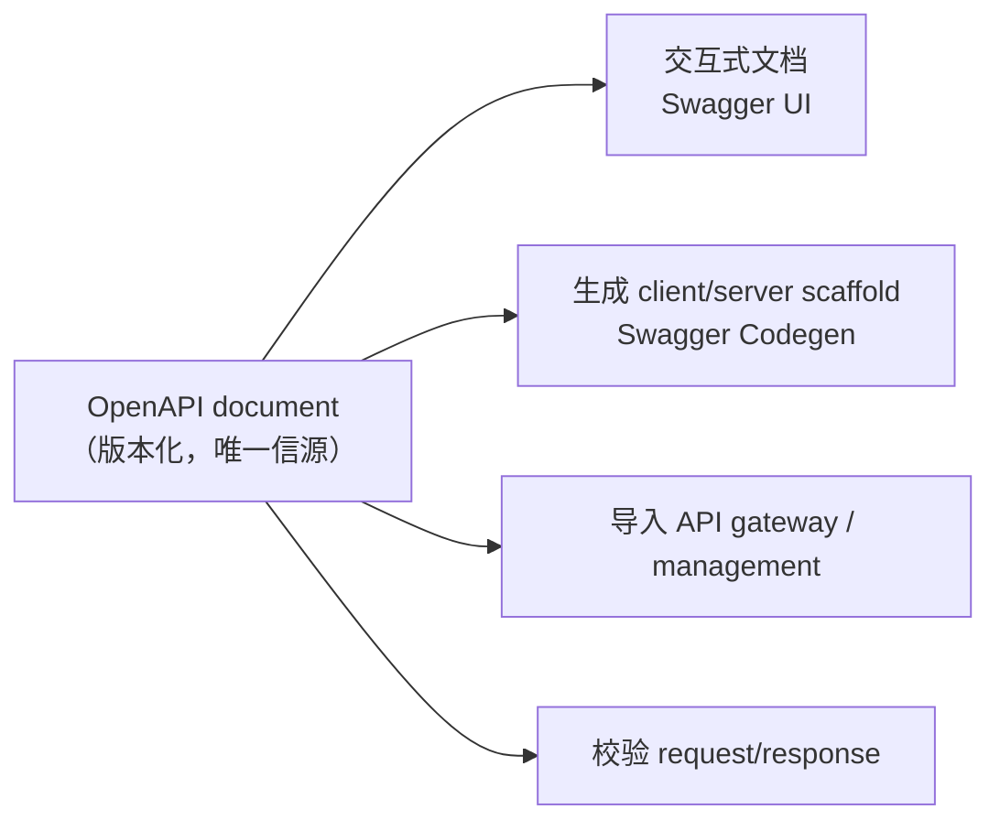

## Definition

OpenAPI Specification（OAS）是与编程语言无关的 HTTP API 描述标准。它让人和工具在不阅读实现代码、额外文档或抓包的情况下，发现并理解服务的能力。

过去常说的 “Swagger API definition” 通常指 Swagger 2.0 或今天的 OpenAPI document。**OpenAPI 是 specification；[[Swagger]] 是围绕它的一组工具与历史名称。**

## Key Terms

| 中文 | English | 含义 |
| --- | --- | --- |
| OpenAPI 规范 | OpenAPI Specification（OAS） | 描述 HTTP API 的标准 |
| OpenAPI 文档 | OpenAPI Document | 按该规范写成的一份 API 描述 |
| 路径项 / 操作 | Path Item / Operation | 一个路径 / 路径加方法对应的操作 |
| 组件 | Components | 可复用的 schema、安全方案等 |
| 安全方案 | Security Scheme | 定义 API 支持的认证方式，类型有 `apiKey`、`http`、`mutualTLS`、`oauth2`、`openIdConnect` |
| 路径模板 | Path Templating | 用 `{}` 标记路径里可替换的部分 |
| 唯一信源 | Source of Truth | 以带版本的 OpenAPI 文档为准 |

## What It Describes

下面是一个符合规范的最小示例（`info` 是必需字段；路径里的 `{projectId}` 必须有对应的 path parameter；`oauth2` 必须声明 `flows`）：

```yaml
openapi: 3.1.0
info:
  title: Prompt API
  version: 1.0.0
servers:
  - url: https://api.example.com/v1
paths:
  /projects/{projectId}/prompts:
    post:
      parameters:
        - name: projectId
          in: path
          required: true
          schema:
            type: string
      security:
        - oauth: [prompt.write]
      responses:
        "200":
          description: Answer returned
components:
  securitySchemes:
    oauth:
      type: oauth2
      flows:
        authorizationCode:
          authorizationUrl: https://login.example.com/authorize
          tokenUrl: https://login.example.com/token
          scopes:
            prompt.write: Create prompts
```

- `servers`: base URL。
- `paths` + method: [[API Endpoint]] operation。
- `parameters`、`requestBody`、`responses`: contract。
- `components.schemas`: reusable data model。
- `securitySchemes` 与 `security`: 所需安全机制和 scope。

当前最新的版本是 OpenAPI Specification v3.2.1（2026 年 9 月 10 日发布）；上面的示例用 3.1.0 的写法，仍然有效。



## What It Does Not Do

OpenAPI document 只描述安全要求；真正的 token 签发、[[Token Validation]] 和 [[Authorization]] 必须由 gateway、authorizer 或 backend 执行。

## Connections

- Designed through [[Endpoint Design]]
- Tooling: [[Swagger]]
- Published or enforced by [[IBM API Connect]] and [[AWS API Gateway]]

## Sources

- [OpenAPI Specification v3.2.1](https://spec.openapis.org/oas/latest.html)
- [OpenAPI Initiative — About](https://www.openapis.org/about)
