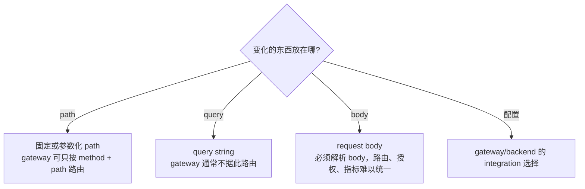

## Definition

“Static URL”和“dynamic URL”不是足够精确的 API 架构术语。讨论前应指出变化的是 host、path parameter、query、request body，还是后端 integration。

## Key Terms

| 中文 | English | 含义 |
| --- | --- | --- |
| 固定路径 | Fixed Path | 路径不含变量 |
| 参数化路径 / 路径模板 | Parameterized Path / Path Templating | 用 `{}` 标出路径里可替换的段 |
| 路径参数 | Path Parameter | 路径模板里被替换的值 |
| 查询参数 | Query Parameter | URL 查询字符串里的参数 |
| 请求体分发 | Body Dispatch | 靠请求体里的字段决定处理逻辑 |
| 动态集成 | Dynamic Integration | 同一路径按配置选择不同 backend |
| 重定向 URI | Redirect URI | OAuth 回调地址，需预先注册并精确匹配 |

## Patterns

| Pattern | Example | 变化位置 |
| --- | --- | --- |
| Fixed path | `/project-a/prompts` | 不变 |
| Parameterized path | `/projects/{projectId}/prompts` | path parameter |
| Query parameter | `/prompts?projectId=project-a` | query string |
| Body dispatch | `POST /prompts` + `projectId` | request body |
| Dynamic integration | 同一路径按配置选择 backend | gateway/backend |

固定 domain 可以同时承载多个固定或参数化 path。OAuth 并不要求业务 API URL 动态变化；相反，授权服务器比较 redirect URI 时必须精确匹配预先注册的值（RFC 9700）。

## Path Templating in OpenAPI

[[OpenAPI Specification]] 用花括号 `{}` 表示路径模板，并规定：

- 路径里的每个模板表达式，必须对应一个路径参数。
- 匹配 URL 时，具体（非模板）的路径优先于模板路径。
- 层级相同但变量名不同的模板路径（如 `/a/{id}` 与 `/a/{name}`）不能同时存在，因为它们等价。

## Gotchas

- 把项目名放在 body 里并非错误，但会让 gateway 难以只靠 method/path 完成 routing、authorization 和 metrics 分组。
- `{projectId}` 是参数化 path，不表示每次临时创建一个 endpoint。
- 客户端不应决定 backend 地址；参数只能在 gateway 配置的受控 integration 范围内映射。

## Connections

- [[API Endpoint]]
- [[API Routing]]
- [[Endpoint Design]]

## Sources

- [OpenAPI Specification: Path Templating](https://spec.openapis.org/oas/latest.html)
- [RFC 9700 — OAuth 2.0 Security Best Current Practice: redirect URI matching](https://www.rfc-editor.org/rfc/rfc9700.html)
