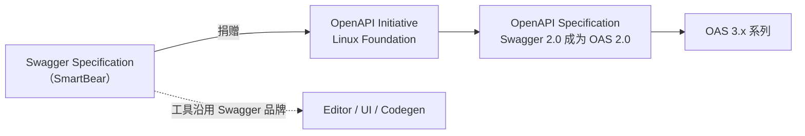

## Definition

Swagger 现在主要指一套围绕 [[OpenAPI Specification]] 的工具生态，例如 Swagger Editor、Swagger UI 和 Swagger Codegen。历史上的 Swagger Specification 由 SmartBear 捐赠给 OpenAPI Initiative（Linux Foundation 下的开放治理组织），之后演变为 OpenAPI Specification；Swagger 2.0 成为 OAS 2.0。

## Key Terms

| 中文 | English | 含义 |
| --- | --- | --- |
| Swagger | Swagger | 围绕 OpenAPI 的工具生态，也是规范的历史名称 |
| OpenAPI 倡议组织 | OpenAPI Initiative（OAI） | 管理 OpenAPI 规范的开放治理组织 |
| 编辑器 | Swagger Editor | 编写并校验 API 描述 |
| 交互式文档 | Swagger UI | 把 API 描述渲染成可交互文档 |
| 代码生成器 | Swagger Codegen | 生成服务端骨架和客户端 SDK |
| 契约 | Contract | 接口的正式描述 |

## History

## Tools

| Tool | Role |
| --- | --- |
| Swagger Editor | 编写与校验 OpenAPI document，支持 Swagger 2.0、OpenAPI 3.* 和 AsyncAPI 2.* |
| Swagger UI | 把 contract 渲染成交互式 API 文档，让人在没有实现的情况下也能查看和试用 API 的资源 |
| Swagger Codegen | 根据 contract 生成 server stub 和 client SDK |

## Gotchas

- “有 Swagger page”不证明 production API 的实现完全符合 contract。
- Swagger UI 能发送 request，不代表它负责 OAuth token 的最终验证。
- API design 应以 versioned OpenAPI document 为 source of truth，而不是只依赖截图或 UI。

## Connections

- Specification: [[OpenAPI Specification]]
- Contract subject: [[API Endpoint]]
- Runtime enforcement: [[API Gateway]]

## Sources

- [OpenAPI Initiative — About](https://www.openapis.org/about)
- [OpenAPI Specification: history](https://spec.openapis.org/oas/latest.html)
- [Swagger Editor](https://swagger.io/tools/swagger-editor/)
- [Swagger UI](https://swagger.io/tools/swagger-ui/)
- [Swagger Codegen](https://swagger.io/tools/swagger-codegen/)
