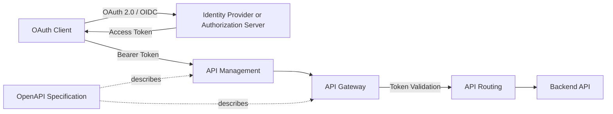

这张 MOC 把 API contract、traffic routing、identity、token validation 和 cloud integration 分开。阅读时始终追问四件事：**谁签发、谁验证、谁授权、谁路由**。

## Core Flow

## API Contract and Routing

- [[API Endpoint]]
- [[Endpoint Design]]
- [[Static and Parameterized API Paths]]
- [[API Routing]]
- [[OpenAPI Specification]]
- [[Swagger]]

## Gateway and Governance

- [[API Gateway]]
- [[API Management]]
- [[IBM API Connect]]
- [[AWS API Gateway]]

## Identity and Tokens

- [[Authentication]]
- [[Authorization]]
- [[Identity Provider]]
- [[OAuth 2.0]]
- [[OpenID Connect]]
- [[OAuth Client]]
- [[Access Token]]
- [[JSON Web Token]]
- [[Token Validation]]
- [[Role-Based Access Control]]

## Enterprise Identity Products

- [[IBM Security Verify Access]]
- [[Microsoft Entra ID]]
- [[Microsoft Entra Group]]
- [[Group Claims]]
- [[App Roles]]
- [[Microsoft Graph]]
- [[Amazon Cognito]]
- [[AWS IAM]]

## Case Study

- [[Gateway-First Multi-Project Routing Case Study]]

