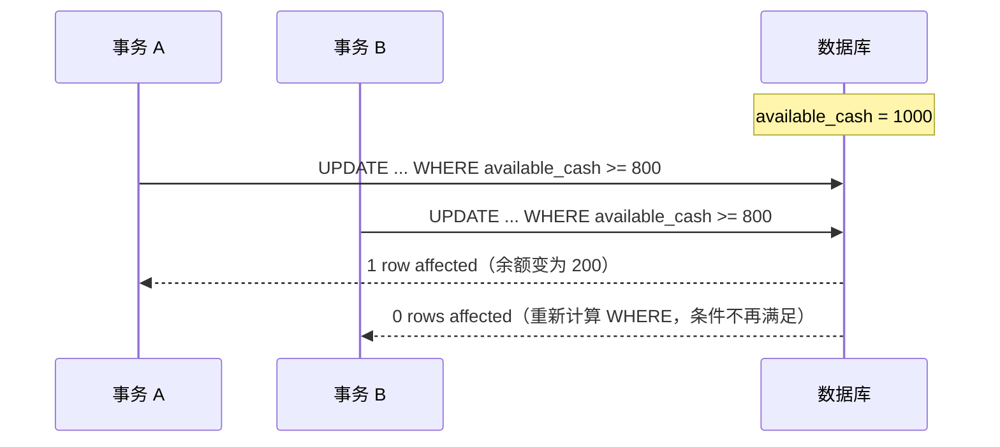

## Definition

Atomic Operation 对外表现为不可再分割的单个操作：它要么成功产生完整效果，要么不产生部分效果。

## Key Terms

| 中文 | English | 含义 |
| --- | --- | --- |
| 原子操作 | Atomic Operation | 对外表现为不可再分割的单个操作 |
| 条件更新 | Conditional Update | 把检查条件和修改放进同一个操作 |
| 影响行数 | Affected Rows | UPDATE 实际修改的行数，用来判断条件是否成立 |
| 多版本并发控制 | MVCC（Multi-Version Concurrency Control） | 用多个行版本协调并发读写的机制 |
| 隔离级别 | Isolation Level | 并发事务之间互相可见的程度 |
| 序列化失败 | Serialization Failure | Repeatable Read 或 Serializable 下因并发冲突而中止事务 |

## Two Concurrent Conditional Updates

下图是 Read Committed 下两个事务争抢同一行的情形：


## Conditional Update

避免超额预留的关键不是先读取余额再更新，而是把条件和修改交给数据库作为同一个操作：

```sql
UPDATE accounts
SET available_cash = available_cash - 800,
    reserved_cash = reserved_cash + 800
WHERE account_id = 123
  AND available_cash >= 800;
```

通过 affected rows 判断预留是否成功。并发问题没有消失，而是由数据库的锁、MVCC 或冲突检测机制协调，具体行为取决于隔离级别。

## Behavior Depends on Isolation Level

以 PostgreSQL 为例，两个事务同时执行上面的语句，抢同一行：

- **Read Committed（默认）**：后到的语句会等待先到的事务结束。如果先到的事务提交了，后到的语句会在更新后的行版本上**重新计算 WHERE 条件**。余额已不足时，条件不再满足，影响行数为 0。
- **Repeatable Read / Serializable**：如果该行在本事务开始之后被其他事务提交修改，本事务不会在新版本上继续，而是报 `could not serialize access due to concurrent update`，应用要从头重试整个事务。

两种结果都不会超额预留，但处理方式不同：前者用 affected rows 判断，后者必须捕获序列化错误并重试。

## Boundaries

- 单行原子操作不自动保护多行约束。
- 单个 DynamoDB Item 的条件更新不等于跨多个 Item 的事务。
- Atomicity 不等于 Isolation，也不等于 Serializability。
- 外部交易已经执行后，数据库事务无法把外部事实回滚。

## Connections

### Coordinated by
- [[Concurrency Control]]
- [[Transaction Isolation]]

### Used to enforce
- [[Data Invariant]]
- [[Idempotency]]

### Implementations
- [[Amazon DynamoDB]]
- [[Database]]

## Sources

- [PostgreSQL — Transaction Isolation: Read Committed](https://www.postgresql.org/docs/current/transaction-iso.html#XACT-READ-COMMITTED)
- [PostgreSQL — Transaction Isolation: Repeatable Read](https://www.postgresql.org/docs/current/transaction-iso.html#XACT-REPEATABLE-READ)
