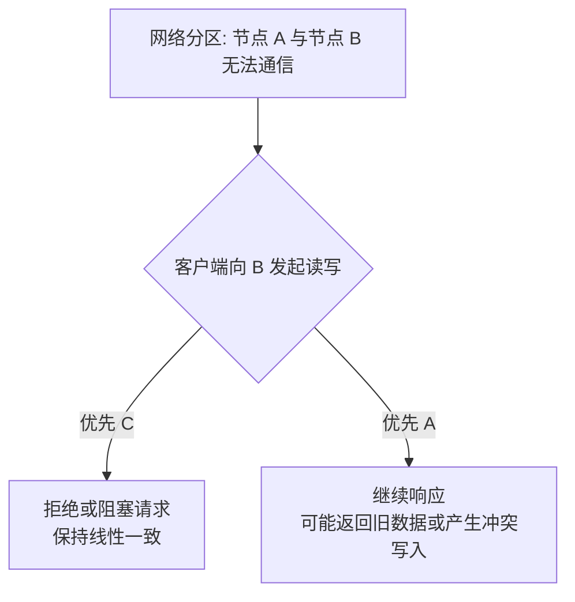

## Definition

CAP Theorem 讨论一个分布式读写对象在发生网络分区时，无法同时保证线性一致性和 CAP 定义下的完全可用性。

| 字母 | 含义 | 严格含义 |
| --- | --- | --- |
| C | Consistency | 操作表现为符合实时顺序的线性一致历史，即 [[Linearizability]] |
| A | Availability | 每个发送到未故障节点的请求最终获得响应 |
| P | Partition tolerance | 即使节点之间的消息丢失或长期延迟，系统仍按既定规则运行 |

## Key Terms

| 中文 | English | 含义 |
| --- | --- | --- |
| CAP 定理 | CAP Theorem | 网络分区时无法同时保证线性一致性和完全可用性 |
| 一致性 | Consistency | 在 CAP 里指线性一致性 |
| 可用性 | Availability | 每个发到未故障节点的请求都得到响应 |
| 分区容错 | Partition Tolerance | 节点间消息丢失或长期延迟时系统仍按规则运行 |
| 网络分区 | Network Partition | 节点之间无法通信 |

## Choice During a Partition

## Decision During a Partition

- 优先 C：拒绝或阻塞无法安全完成的操作。
- 优先 A：继续响应，但可能返回旧数据或接受冲突写入。

实际系统通常按操作做取舍，而不是给整个产品贴上 CP 或 AP 标签。关键资金写入可以拒绝不安全请求，非关键只读内容则可能接受旧数据。

## Gotchas

- CAP 不是“平时只能任意选择两个”。关键约束发生在网络分区期间。
- CAP 的 Availability 不等于日常使用的 uptime 或 SLA。形式化定义是：每个发送到未故障节点的请求都必须得到响应。
- CAP 的 C 不是 ACID 的 C，也不是 [[Serializability]]，见 [[Consistency]]。
- CAP 不直接回答延迟、成本、备份和灾难恢复问题。

## Connections

### Broader concept
- [[Consistency]]
- [[Linearizability]]
- [[Consistency Models]]

### Business constraints
- [[Data Invariant]]
- [[High Availability]]

## Sources

- [Gilbert & Lynch — Brewer's Conjecture and the Feasibility of Consistent, Available, Partition-Tolerant Web Services](https://groups.csail.mit.edu/tds/papers/Gilbert/Brewer2.pdf)
- [Perspectives on the CAP Theorem — MIT](https://dspace.mit.edu/entities/publication/dfcb6512-af44-4fc9-8e8b-1a8f28f1b53a)

