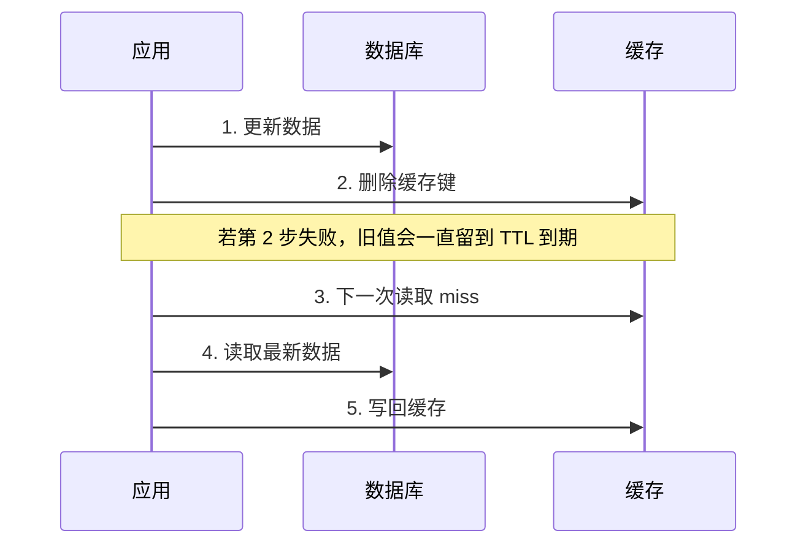

## Definition

Cache Invalidation 是在源数据变化后删除、更新或自然淘汰旧缓存的过程。

## Key Terms

| 中文 | English | 含义 |
| --- | --- | --- |
| 缓存失效 | Cache Invalidation | 源数据变化后删除、更新或淘汰旧缓存 |
| 过期时间 | TTL（Time To Live） | 缓存项自动过期前的存活时间 |
| 写穿 | Write-Through | 写数据库时同步更新缓存 |
| 主动失效 | Explicit Invalidation | 数据变化后主动删除缓存键 |
| 版本化键 | Versioned Key | 把版本放进键名，避免新旧数据冲突 |
| 缓存踩踏 | Cache Stampede | 热点键同时过期，大量请求同时回源（常被称为缓存击穿） |
| 权威数据源 | Source of Truth | 以其内容为准的数据来源 |

## Write Path and Failure Window

## Common Strategies

- **TTL**：在限定时间后自动过期。不保证不过期，但限制了过期的程度。
- **Write-through**：写入数据库时同步更新缓存，缓存里的数据不会过期，但每次写入多一次操作。
- **Explicit invalidation**：数据变化后主动删除缓存键，下一次读取时回源重建。这是 Cache-Aside 的常规做法：先更新数据源，再让对应缓存项失效。
- **Versioned key**：把版本放进 Key，避免新旧数据冲突。

实际中常把 TTL 与主动失效组合：主动失效负责及时，TTL 作为兜底，即使一次失效消息丢失，旧数据也最终会过期。

## Gotchas

- 更新数据库和删除缓存是两个操作，存在部分失败窗口：数据库已更新而缓存没删掉，旧值会一直留到 TTL 到期。
- Cache-Aside 不保证缓存与数据源一致。例如外部进程直接修改了数据源，缓存在该项重新加载前不会反映。
- TTL 越短不一定越好，过早过期会让应用持续回源，增加后端负载。
- 热点 Key 同时过期可能形成 Cache Stampede，给 TTL 加 jitter、用 request coalescing 缓解。
- 本地（进程内）缓存每个实例各有一份副本，实例之间很容易不一致，可能需要更短的过期时间或共享缓存。
- 关键业务判断需要明确 Source of Truth，不能把缓存当成权威账本。

## Connections

### Part of
- [[Caching]]

### Related concepts
- [[Consistency]]
- [[Reliable Asynchronous Processing]]

## Sources

- [Azure Architecture Center — Cache-Aside pattern](https://learn.microsoft.com/en-us/azure/architecture/patterns/cache-aside)
- [AWS — Caching strategies](https://docs.aws.amazon.com/whitepapers/latest/database-caching-strategies-using-redis/caching-patterns.html)
- [AWS Builders' Library — Caching challenges and strategies](https://aws.amazon.com/builders-library/caching-challenges-and-strategies/)
