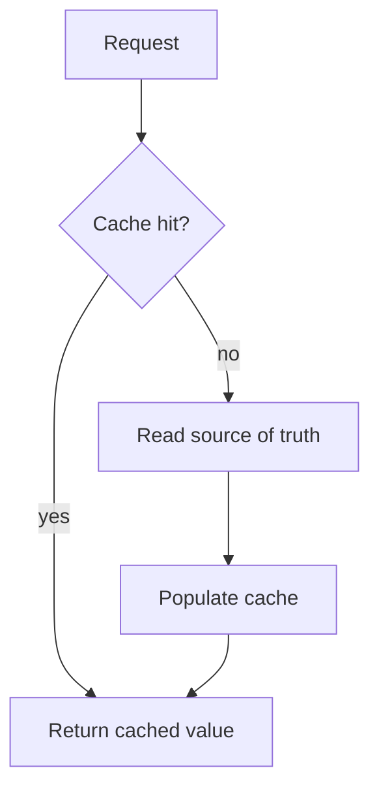

## Definition

Caching 通过保存可重复使用的数据副本降低读取延迟和后端负载，但会引入数据新鲜度和失效问题。

## Cache-Aside

## Appropriate Use

- 静态或变化较慢的账户资料可以使用较长 TTL。
- 市场数据的缓存策略取决于产品允许的延迟。
- Buying Power 等关键写入判断不应仅依赖可能过期的缓存值。

## Risks

- Stale data
- Hot key
- Cache penetration
- Cache stampede
- 缓存故障后数据库被瞬间放大流量

## Connections

### Correctness
- [[Consistency]]
- [[Cache Invalidation]]

### Operations
- [[Observability]]

