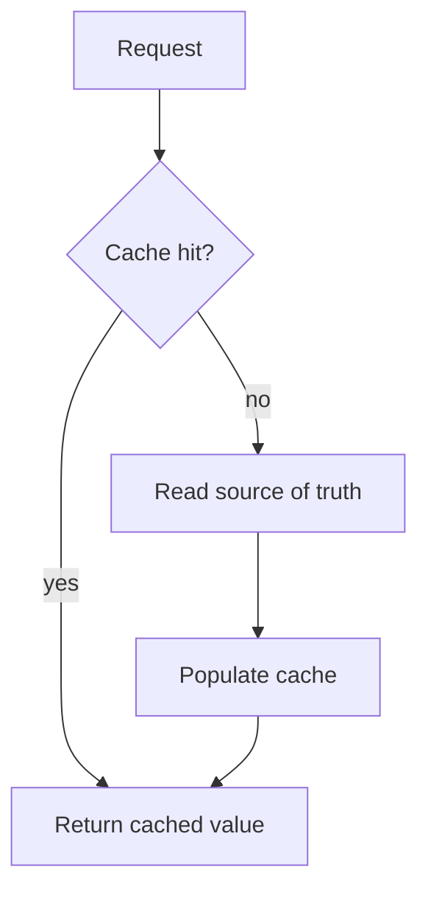

## Definition

Caching 通过保存可重复使用的数据副本降低读取延迟和后端负载，但会引入数据新鲜度和失效问题。

## Key Terms

| 中文 | English | 含义 |
| --- | --- | --- |
| 缓存 | Cache | 可重复使用的数据副本 |
| 命中 / 未命中 | Cache Hit / Cache Miss | 请求能 / 不能从缓存得到数据 |
| 旁路缓存（懒加载） | Cache-Aside（Lazy Loading） | 未命中时才回源并写入缓存 |
| 写穿 | Write-Through | 写数据库时同步写缓存 |
| 缓存穿透 | Cache Penetration | 反复查询数据源里也不存在的数据，请求每次都穿过缓存 |
| 缓存踩踏 / 惊群 | Cache Stampede / Thundering Herd | 大量请求同时需要同一个未缓存的资源 |
| 热点键 | Hot Key | 承担大部分流量的少数键 |
| 请求合并 | Request Coalescing | 同一资源同一时刻只让一个请求回源 |
| 负缓存 | Negative Cache | 缓存“不存在”或错误结果，使用不同于正常条目的 TTL |
| 软 / 硬 TTL | Soft TTL / Hard TTL | 到软 TTL 时尝试刷新，到硬 TTL 才不再使用旧数据 |
| 冷启动 | Cold Start | 带着空缓存启动，请求骤增 |

## When a Cache Helps

AWS Builders' Library 提出两个判断条件：

- **命中率**：不同请求能否复用同一份结果。如果每个请求的查询都唯一，命中率可忽略，缓存没有意义。
- **对最终一致的容忍度**：缓存的数据会随时间与数据源不一致，服务和客户端都必须能接受。变化慢的数据可以缓存更久。

## Strategies

### Cache-Aside (Lazy Loading)

- 优点：只缓存被请求过的数据；缓存节点故障不致命，只是延迟上升。
- 缺点：未命中时要三步（查缓存、查数据库、写缓存），有额外延迟；缓存可能过期，因为数据库变化时缓存不会自动更新。
- 写入时，应用先写数据源，再让对应缓存项失效。写入后到下一次读取之间，读者可能遇到未命中或短暂读到旧数据。

### Write-Through

每次写数据库时同步写缓存。

- 优点：缓存里的数据不会过期；把延迟放在写入上，用户通常更能接受更新慢于读取。
- 缺点：新节点上线时缓存缺数据，直到该数据被写入或更新；大部分数据可能从不被读取，造成缓存空间浪费。
- 通常与 Lazy Loading 搭配，并给每个键加 TTL。

### TTL

TTL 让键在一段时间后过期，过期键被视为不存在，下一次读取会回源并更新缓存。它不保证数据不过期，只限制过期的程度。TTL 过短会让应用持续回源。

## Failure Modes

| 现象 | 含义 | 常见对策 |
| --- | --- | --- |
| Stale data | 缓存与数据源不一致 | TTL、主动失效、write-through |
| Hot key | 少数键承担大部分流量，使单个缓存节点或下游分区成为瓶颈 | 需要结合访问模式单独分析 |
| Cache penetration | 反复查询数据源里也不存在的数据，请求每次都穿过缓存 | 缓存“不存在”的结果（negative cache，使用不同于正常条目的 TTL） |
| Cache stampede / Thundering herd | 大量请求同时需要同一个未缓存的资源，一起打到下游 | Request coalescing：同一时刻只让一个请求回源；TTL 加 jitter |
| Cold start | 新服务器带着空缓存启动，或缓存被整体清空，请求骤增 | Request coalescing、预热 |
| 缓存故障 | 缓存整体不可用，流量全部回源 | 本地缓存兜底、load shedding、限制回源速率 |

AWS Builders' Library 还提醒两点：

- **缓存依赖症**：缓存从“辅助”变成服务“必需”，一旦命中率下降，下游会被压垮。要在关闭缓存的情况下做负载测试。
- **Soft TTL / Hard TTL**：到达 soft TTL 时尝试刷新，下游不可用就继续用旧数据，直到 hard TTL。

## Appropriate Use

- 变化较慢的资料（用户资料、配置）可以使用较长 TTL。
- 行情、统计类数据的缓存策略取决于产品允许的延迟。
- 库存、余额等关键写入判断不应仅依赖可能过期的缓存值，要以 source of truth 为准。

## Connections

### Correctness
- [[Consistency]]
- [[Cache Invalidation]]

### Resilience
- [[Exponential Backoff and Jitter]]
- [[Graceful Degradation]]

### Operations
- [[Observability]]

## Sources

- [AWS — Caching strategies (lazy loading, write-through, TTL)](https://docs.aws.amazon.com/whitepapers/latest/database-caching-strategies-using-redis/caching-patterns.html)
- [AWS Builders' Library — Caching challenges and strategies](https://aws.amazon.com/builders-library/caching-challenges-and-strategies/)
- [Azure Architecture Center — Cache-Aside pattern](https://learn.microsoft.com/en-us/azure/architecture/patterns/cache-aside)
